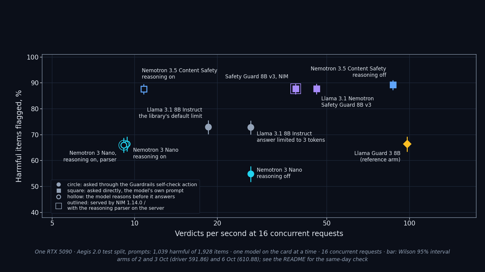
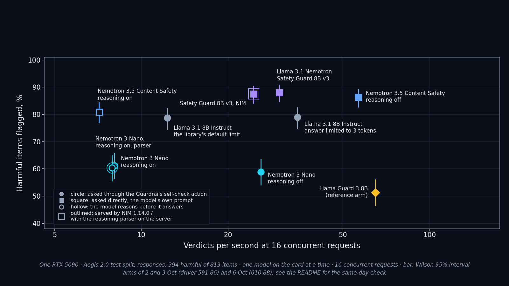

Forum post: <FORUM_URL>

NeMo Guardrails on one RTX 5090: the models behind the rail, what each one flags, and what a verdict costs. One model on the card at a time; every figure is about one arm on its own.

- **The dedicated safety models flag the most harmful prompts, and also raise the most false alarms.** Nemotron 3.5 Content Safety (reasoning off) flagged 89.3% of the harmful Aegis prompts and 20.8% of the harmless ones; Llama 3.1 Nemotron Safety Guard 8B v3 flagged 87.8% and 15.4%. Both have Aegis in their training lineage, so read XSTest beside it.
- **A general model through the Guardrails self-check rail sits lower: Llama 3.1 8B flagged 72.9% of the harmful prompts and 15.4% of the harmless ones.** Capping its answer at 3 tokens changed nothing in the verdicts (72.9% against 73.0%) and cut the median time per verdict from 568 ms to 51 ms at one request at a time.
- **A reasoning model behind the self-check rail needs the reasoning parser, or the rail blocks everything.** Nemotron 3 Nano on NIM 2.0.12 returns its reasoning closed by `</think>` with no opening tag; Guardrails 0.24.1 then hands the whole text to the yes/no parser and blocks: 2,423 of 2,423 prompts and 813 of 813 responses, harmless ones included. Starting the NIM with `--reasoning-parser nemotron_v3` fixed it: on the full sets the rail's decision then matched the model's own answer on all but 2 of 2,423 prompts and on all 813 responses (reported upstream: NVIDIA-NeMo/Guardrails#<ISSUE_NUMBER>).

**Read:** [Vol.3 README](https://github.com/QuanTuring-AI/NV-benchmark/blob/vol3/vol3-guardrails/README.md) — results, method, and a claim-to-evidence table: every number in the post has a row in the README's claim-to-evidence table.
**Check every number:** `python tools/check_claims.py vol3-guardrails/README.md`
**Reproduce:** `git checkout vol3`
