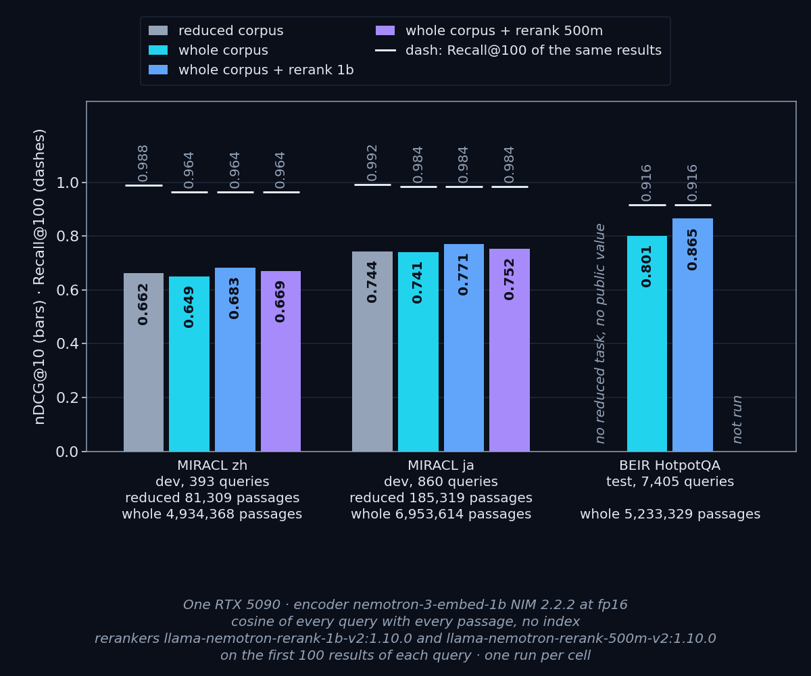
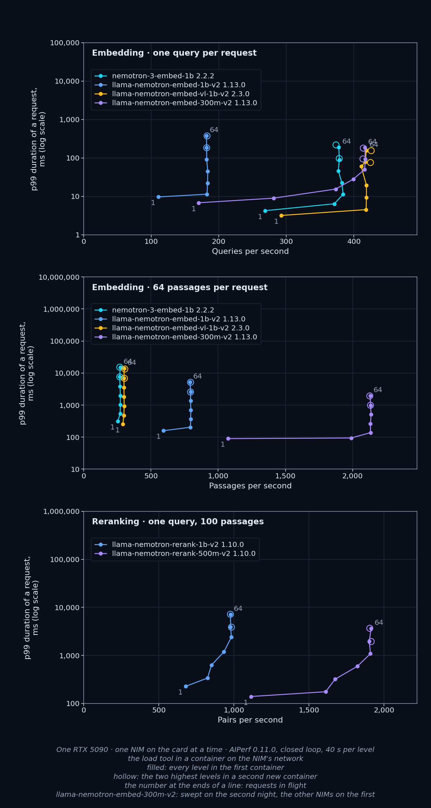

Nemotron retrieval on one RTX 5090: the embedding and reranking NIMs on public data sets, with every passage of the corpus searched (4.9M passages of MIRACL zh, 7.0M of ja, and the whole of BEIR HotpotQA), and where each NIM stops getting faster. One model on the card at a time; exact search, no vector database.

- **Expect less than the benchmark on a real corpus, especially in Chinese.** `nemotron-3-embed-1b` (NIM 2.2.2, fp16) scored nDCG@10 0.662 on the reduced MIRACL zh corpus (81,309 passages) and 0.649 on the whole one (4,934,368); Recall@100 fell from 0.988 to 0.964. On Japanese the drop was small: 0.744 on 185,319 passages, 0.741 on 6,953,614.
- **Rerank the top 100.** `llama-nemotron-rerank-1b-v2` lifted nDCG@10 from 0.649 to 0.683 on MIRACL zh, from 0.741 to 0.771 on ja, and from 0.801 to 0.865 on BEIR HotpotQA (5,233,329 passages, 7,405 queries). The 500m reranker added less (+0.020 zh, +0.011 ja) and served 1.6 times the pairs per second at one request at a time.
- **Size the reranker, not the embedder.** With 100 passages per query, the 1b reranker topped out at about 10 queries per second on this card and the 500m one at about 19; embedding one query topped out at 384 requests per second for `nemotron-3-embed-1b`. On this card, most embedding NIMs stopped getting faster at 2 concurrent requests and the rerankers at 8–16; past that point more concurrency only adds waiting. These are each NIM alone on the card; two NIMs sharing one card will do less.
- **Store the vectors as fp16.** Every value this NIM returns survives the round trip to 16-bit floats, so the three whole-corpus stores went from 140 GB to 70 GB with identical rankings. Stored as 8-bit integers, nDCG@10 and Recall@100 showed no loss on the three corpora, but the top 10 came back in the same order for only 33–58% of the queries.
- **The NIM gives the quality of the open weights.** On the reduced MIRACL task, the NIM of `nemotron-3-embed-1b` and the open weights differ by 0.0011 (zh) and 0.0001 (ja) nDCG@10. The public MTEB value for ja (0.742) is reproduced within 0.002; the public zh value (0.642) is not reproduced by our harness (0.663) or by MTEB itself run here (0.663), and we do not know why.

Two nights repeated 19 levels within 2.1%, and the load tool, checked against a server that answers instantly, went at least 2.99 times faster than any NIM it measured.

**Read:** [Vol.4 README](https://github.com/QuanTuring-AI/NV-benchmark/blob/vol4/vol4-retriever/README.md) — results, method, and a claim-to-evidence table: every number in the post has a row in the README's claim-to-evidence table.
**Check every number:** `python tools/check_claims.py vol4-retriever/README.md`
**Reproduce:** `git checkout vol4`
