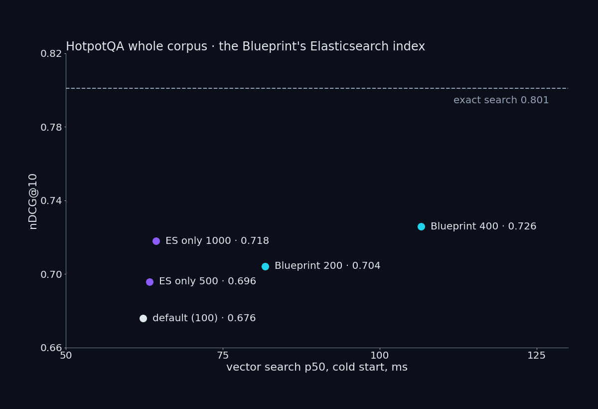

The NVIDIA RAG Blueprint (v2.6.2) query path as it ships, with its defaults, on one RTX 5090: Elasticsearch as the vector store, the Llama Nemotron reranking NIM and Nemotron 3 Nano as the answer model, against every passage of BEIR HotpotQA (5,233,329 passages, 7,405 questions) and of MIRACL zh (4,934,368 passages). Three changes from the shipped defaults, each with a control: the embedding model is `nemotron-3-embed-1b` (the Vol.4 vectors), the answer model is Nemotron 3 Nano NVFP4 (the default 120B model needs two cards), and the vectors were loaded into the Blueprint's own index mapping directly.

- **Retrieval moves the answer from 30% to 53%; exact search in place of the default index takes it to 60%; the right passages would take it to 73%.** On 7,405 HotpotQA questions the answer contained the official answer 30.4% of the time with the knowledge base off, 53.4% through the Blueprint's default path, 60.4% with exact search's top 100 and the same reranker and model, and 72.8% with the two supporting passages.
- **The default vector store costs 0.125 nDCG@10 on 5.2M passages, and the only knob gets 0.05 back.** Elasticsearch's default index (`bbq_hnsw`, 100 candidates) scored 0.676 where exact search over the same vectors scores 0.801; `VECTOR_DB_TOPK` tops out at 400 (0.726), with the median search going from 62 to 107 ms. Hybrid search does not open another way on the shipped Elasticsearch: the default ranker is refused under its basic licence, and the weighted ranker caps `VECTOR_DB_TOPK` at 100.
- **Text ingestion drops the last token of every chunk and can guess the wrong encoding.** 99,721 of 100,000 passages lost their final token and 249 were stored garbled, in the nv-ingest 26.3.0 the Blueprint pins.
- **With the default context length, every default request is refused.** The Blueprint sends `max_tokens` 16256; at a 16,384-token context all 200 test questions were refused, at 32,768 all 200 answered.
- **The reasoning budget of 256 tokens has no effect, and by default the reasoning comes back inside the answer** unless the NIM is started with `--reasoning-parser nemotron_v3`.
- **When the supporting passages are not in the corpus, the model refuses at least a third of the time and still answers the rest** (200 questions: 33.5% refusals by pattern, 54% in a 50-question manual check).
- **Three NIMs fit on the card after start-up, at one memory ratio** (`gpu_memory_utilization` 0.65); at the NIM's default 0.92, 4,239 MiB was paged to system memory in steady state.
- **The whole path, co-resident, answers a HotpotQA question in 1.2 s median at one request, 2.2 s at four.**
- **Start-up of the answer NIM pages up to 2,980 MiB on this Windows host;** it settles once the model is ready.

**Read:** [Vol.5 README](https://github.com/QuanTuring-AI/NV-benchmark/blob/vol5/vol5-rag-blueprint/README.md) — results, method, the Blueprint settings table, and a claim-to-evidence table: every number in the post has a row in the README's claim-to-evidence table.
**Check every number:** `python tools/check_claims.py vol5-rag-blueprint/README.md`
**Reproduce:** `git checkout vol5`
