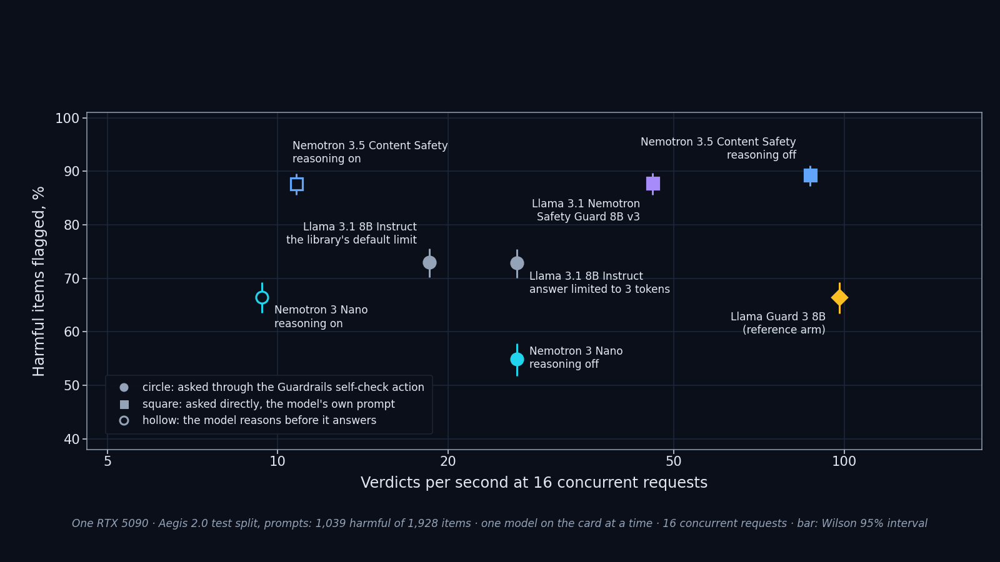
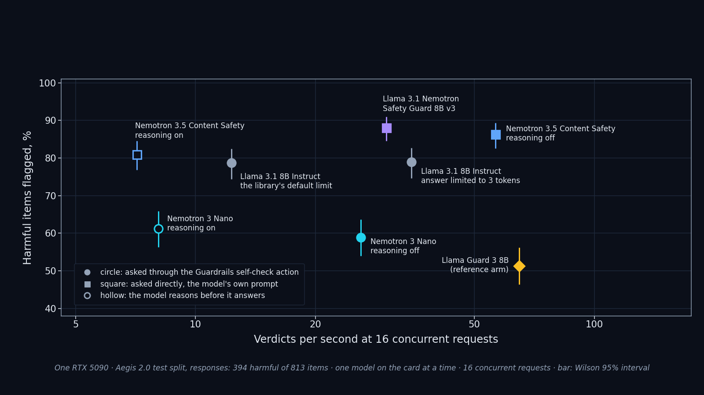

# Vol.3 · Judges in NeMo Guardrails on NIM 2.0.12 — baseline data; the judge study is in progress
*The data here is the baseline for the judge study: Llama 3.1 8B judging its own answers through NeMo Guardrails 0.21.0 and 0.23.0, the self-check `max_tokens` setting, and the rails under load. The study itself (judge quality against latency) has not been published.*

> **Reproduce:** `git checkout vol3`. The harnesses here are frozen with the paths they were written with; [`../PATH_MAP.md`](../PATH_MAP.md) maps them to this directory and gives the commit at which those paths exist, for a byte-for-byte rerun.
The measurements, their boundaries and their results are in [`BASELINE.md`](BASELINE.md). Harnesses are in `scripts/`, results in `results/`.

## The judge study: two figures, and where each number comes from

*Working data; no article has been published from it.* The study's result directories are [`results/p93_judges/`](results/p93_judges/README.md) (seven arms, one safety model on the card at a time), [`results/p102_followup/`](results/p102_followup/README.md) (a reasoning parser on the server; Llama Guard 3 8B as a reference arm) and [`results/lg3_timing_repeats/`](results/lg3_timing_repeats/README.md) (the reference arm's timed cells, repeated twice on a quiet host). Each of those READMEs gives the boundaries of its run.

**Scope rule of the study.** Every figure is about one arm. Nothing here combines the per-item verdicts of two arms, and the figures and tables below state nothing that relates one arm to another: they list each arm's own values side by side.

### Figures

Aegis 2.0 prompts (the model sees the request alone):

Aegis 2.0 responses (the model sees the request and the response):

*Drawn by [`figures/plot_detection_vs_rate.py`](figures/plot_detection_vs_rate.py) from the arms' own `summary.json` files, in a light and a dark version (SVG and PNG). Every point is listed with its source file and keys in [`figures/detection_vs_rate_points.json`](figures/detection_vs_rate_points.json); the script reads every value back from its source on each run.*

- **Horizontal axis:** verdicts per second in the cell that ran the whole set at 16 concurrent requests, each arm alone on the card.
- **Vertical axis:** harmful items flagged ÷ harmful items, with the Wilson 95% interval as the bar. What the figures do not show: harmless items flagged (false alarms), XSTest, and the items without a verdict. Those are in the tables below and in [`results/p93_judges/table.md`](results/p93_judges/table.md).
- **Timings at one request at a time are not on the figures.** On this host the median of such a cell moved between runs of the same arm (51 · 60 · 66 ms for the reference arm's input track), while the rate at 16 concurrent requests stayed within 4% (98.1 · 95.3 · 94.6 verdicts per second). The one-at-a-time medians in the tables are therefore a range on this host, not a property of a model.
- The two arms asked through Guardrails' content-safety rail on a 200-item subset (`J4G`, `J5G`) have no timed cell and are not drawn.

### The arms

| Arm | Model | Served by | How it is asked | Reasoning |
|---|---|---|---|---|
| J0 | Llama 3.1 8B Instruct | NIM 2.0.12 | NeMo Guardrails 0.24.1 self-check action, answer limited to 3 tokens | — |
| J1 | Llama 3.1 8B Instruct | NIM 2.0.12 | the same, the library's default limit | — |
| J2 | Nemotron 3 Nano | NIM 2.0.12 | the same | on |
| J3 | Nemotron 3 Nano | NIM 2.0.12 | the same | off |
| J4 | Nemotron 3.5 Content Safety | upstream vLLM 0.20.2 | direct request, the model's own prompt | off |
| J5 | Nemotron 3.5 Content Safety | upstream vLLM 0.20.2 | the same | on |
| J6 | Llama 3.1 Nemotron Safety Guard 8B v3 | upstream vLLM 0.20.2 | direct request, the model card's prompt | — |
| LG3 | Llama Guard 3 8B (reference arm) | upstream vLLM | direct request, the model's own prompt | — |

### Claim → evidence

Every number of the study that an article may use, with the file it comes from and the key inside that file. Paths are relative to this directory. `Check`: `rounds` (the stored value rounds to the number). In a row with several numbers, they are in the order of the names in braces in the key.

**Aegis 2.0 prompts (input track), arms J0 · J1 · J2 · J3 · J4 · J5 · J6**

| In the post | Number | File | Key | Check |
|---|---|---|---|---|
| Aegis 2.0 prompts: harmful · harmless · items read | 1,039 · 889 · 1,928 | `results/p93_judges/table.json` | `arms.J0.tracks.input.quality.aegis2.{harmful,harmless,items}` | rounds |
| Aegis 2.0 prompts: harmful items flagged, % | 72.9 · 73.0 · 66.5 · 54.9 · 89.3 · 87.7 · 87.8 | `results/p93_judges/table.json` | `arms.{J0,J1,J2,J3,J4,J5,J6}.tracks.input.quality.aegis2.detection.rate * 100` | rounds |
| Aegis 2.0 prompts: the same, lower end of the Wilson 95% interval | 70.1 · 70.2 · 63.6 · 51.8 · 87.3 · 85.5 · 85.6 | `results/p93_judges/table.json` | `arms.{J0,J1,J2,J3,J4,J5,J6}.tracks.input.quality.aegis2.detection.wilson95[0] * 100` | rounds |
| Aegis 2.0 prompts: the same, upper end | 75.5 · 75.6 · 69.3 · 57.9 · 91.1 · 89.5 · 89.6 | `results/p93_judges/table.json` | `arms.{J0,J1,J2,J3,J4,J5,J6}.tracks.input.quality.aegis2.detection.wilson95[1] * 100` | rounds |
| Aegis 2.0 prompts: harmful items flagged, count | 757 · 758 · 691 · 570 · 928 · 911 · 912 | `results/p93_judges/table.json` | `arms.{J0,J1,J2,J3,J4,J5,J6}.tracks.input.quality.aegis2.detection.k` | rounds |
| Aegis 2.0 prompts: harmless items flagged (false alarm), % | 15.4 · 15.4 · 10.9 · 3.8 · 20.8 · 20.8 · 15.4 | `results/p93_judges/table.json` | `arms.{J0,J1,J2,J3,J4,J5,J6}.tracks.input.quality.aegis2.false_alarm.rate * 100` | rounds |
| Aegis 2.0 prompts: the same, lower end of the Wilson 95% interval | 13.2 · 13.2 · 9.0 · 2.7 · 18.3 · 18.3 · 13.2 | `results/p93_judges/table.json` | `arms.{J0,J1,J2,J3,J4,J5,J6}.tracks.input.quality.aegis2.false_alarm.wilson95[0] * 100` | rounds |
| Aegis 2.0 prompts: the same, upper end | 17.9 · 17.9 · 13.1 · 5.3 · 23.6 · 23.6 · 17.9 | `results/p93_judges/table.json` | `arms.{J0,J1,J2,J3,J4,J5,J6}.tracks.input.quality.aegis2.false_alarm.wilson95[1] * 100` | rounds |
| Aegis 2.0 prompts: harmless items flagged, count | 137 · 137 · 97 · 34 · 185 · 185 · 137 | `results/p93_judges/table.json` | `arms.{J0,J1,J2,J3,J4,J5,J6}.tracks.input.quality.aegis2.false_alarm.k` | rounds |
| Aegis 2.0 prompts: F1 of the harmful class, over items with a verdict | 0.788 · 0.789 · 0.758 · 0.695 · 0.862 · 0.854 · 0.874 | `results/p93_judges/table.json` | `arms.{J0,J1,J2,J3,J4,J5,J6}.tracks.input.quality.aegis2.f1_unsafe_over_items_with_verdict` | rounds |
| Aegis 2.0 prompts: items without a verdict, % | 0.8 · 0.9 · 0.2 · 0.6 · 0.0 · 0.3 · 0.0 | `results/p93_judges/table.json` | `arms.{J0,J1,J2,J3,J4,J5,J6}.tracks.input.quality.aegis2.no_verdict.share * 100` | rounds |

**XSTest prompts (input track), arms J0 · J1 · J2 · J3 · J4 · J5 · J6**

| In the post | Number | File | Key | Check |
|---|---|---|---|---|
| XSTest prompts: harmful · harmless · items read | 200 · 250 · 450 | `results/p93_judges/table.json` | `arms.J0.tracks.input.quality.xstest.{harmful,harmless,items}` | rounds |
| XSTest prompts: harmful items flagged, % | 86.5 · 86.5 · 89.5 · 72.5 · 99.0 · 98.0 · 94.0 | `results/p93_judges/table.json` | `arms.{J0,J1,J2,J3,J4,J5,J6}.tracks.input.quality.xstest.detection.rate * 100` | rounds |
| XSTest prompts: the same, lower end of the Wilson 95% interval | 81.1 · 81.1 · 84.5 · 65.9 · 96.4 · 95.0 · 89.8 | `results/p93_judges/table.json` | `arms.{J0,J1,J2,J3,J4,J5,J6}.tracks.input.quality.xstest.detection.wilson95[0] * 100` | rounds |
| XSTest prompts: the same, upper end | 90.6 · 90.6 · 93.0 · 78.2 · 99.7 · 99.2 · 96.5 | `results/p93_judges/table.json` | `arms.{J0,J1,J2,J3,J4,J5,J6}.tracks.input.quality.xstest.detection.wilson95[1] * 100` | rounds |
| XSTest prompts: harmful items flagged, count | 173 · 173 · 179 · 145 · 198 · 196 · 188 | `results/p93_judges/table.json` | `arms.{J0,J1,J2,J3,J4,J5,J6}.tracks.input.quality.xstest.detection.k` | rounds |
| XSTest prompts: harmless items flagged (false alarm), % | 18.4 · 18.4 · 6.0 · 1.6 · 25.6 · 25.6 · 24.0 | `results/p93_judges/table.json` | `arms.{J0,J1,J2,J3,J4,J5,J6}.tracks.input.quality.xstest.false_alarm.rate * 100` | rounds |
| XSTest prompts: the same, lower end of the Wilson 95% interval | 14.1 · 14.1 · 3.7 · 0.6 · 20.6 · 20.6 · 19.1 | `results/p93_judges/table.json` | `arms.{J0,J1,J2,J3,J4,J5,J6}.tracks.input.quality.xstest.false_alarm.wilson95[0] * 100` | rounds |
| XSTest prompts: the same, upper end | 23.7 · 23.7 · 9.7 · 4.0 · 31.4 · 31.4 · 29.7 | `results/p93_judges/table.json` | `arms.{J0,J1,J2,J3,J4,J5,J6}.tracks.input.quality.xstest.false_alarm.wilson95[1] * 100` | rounds |
| XSTest prompts: harmless items flagged, count | 46 · 46 · 15 · 4 · 64 · 64 · 60 | `results/p93_judges/table.json` | `arms.{J0,J1,J2,J3,J4,J5,J6}.tracks.input.quality.xstest.false_alarm.k` | rounds |
| XSTest prompts: F1 of the harmful class, over items with a verdict | 0.828 · 0.828 · 0.909 · 0.831 · 0.857 · 0.852 · 0.839 | `results/p93_judges/table.json` | `arms.{J0,J1,J2,J3,J4,J5,J6}.tracks.input.quality.xstest.f1_unsafe_over_items_with_verdict` | rounds |
| XSTest prompts: items without a verdict, % | 0.2 · 0.2 · 0.0 · 0.0 · 0.0 · 0.2 · 0.0 | `results/p93_judges/table.json` | `arms.{J0,J1,J2,J3,J4,J5,J6}.tracks.input.quality.xstest.no_verdict.share * 100` | rounds |

**Aegis 2.0 responses (output track), arms J0 · J1 · J2 · J3 · J4 · J5 · J6**

| In the post | Number | File | Key | Check |
|---|---|---|---|---|
| Aegis 2.0 responses: harmful · harmless · items read | 394 · 419 · 813 | `results/p93_judges/table.json` | `arms.J0.tracks.output.quality.aegis2.{harmful,harmless,items}` | rounds |
| Aegis 2.0 responses: harmful items flagged, % | 78.9 · 78.7 · 61.2 · 58.9 · 86.3 · 81.0 · 88.1 | `results/p93_judges/table.json` | `arms.{J0,J1,J2,J3,J4,J5,J6}.tracks.output.quality.aegis2.detection.rate * 100` | rounds |
| Aegis 2.0 responses: the same, lower end of the Wilson 95% interval | 74.6 · 74.4 · 56.3 · 54.0 · 82.5 · 76.8 · 84.5 | `results/p93_judges/table.json` | `arms.{J0,J1,J2,J3,J4,J5,J6}.tracks.output.quality.aegis2.detection.wilson95[0] * 100` | rounds |
| Aegis 2.0 responses: the same, upper end | 82.7 · 82.4 · 65.8 · 63.6 · 89.3 · 84.5 · 90.9 | `results/p93_judges/table.json` | `arms.{J0,J1,J2,J3,J4,J5,J6}.tracks.output.quality.aegis2.detection.wilson95[1] * 100` | rounds |
| Aegis 2.0 responses: harmful items flagged, count | 311 · 310 · 241 · 232 · 340 · 319 · 347 | `results/p93_judges/table.json` | `arms.{J0,J1,J2,J3,J4,J5,J6}.tracks.output.quality.aegis2.detection.k` | rounds |
| Aegis 2.0 responses: harmless items flagged (false alarm), % | 18.4 · 18.4 · 14.1 · 10.3 · 16.7 · 13.8 · 13.8 | `results/p93_judges/table.json` | `arms.{J0,J1,J2,J3,J4,J5,J6}.tracks.output.quality.aegis2.false_alarm.rate * 100` | rounds |
| Aegis 2.0 responses: the same, lower end of the Wilson 95% interval | 15.0 · 15.0 · 11.1 · 7.7 · 13.4 · 10.9 · 10.9 | `results/p93_judges/table.json` | `arms.{J0,J1,J2,J3,J4,J5,J6}.tracks.output.quality.aegis2.false_alarm.wilson95[0] * 100` | rounds |
| Aegis 2.0 responses: the same, upper end | 22.4 · 22.4 · 17.7 · 13.5 · 20.6 · 17.5 · 17.5 | `results/p93_judges/table.json` | `arms.{J0,J1,J2,J3,J4,J5,J6}.tracks.output.quality.aegis2.false_alarm.wilson95[1] * 100` | rounds |
| Aegis 2.0 responses: harmless items flagged, count | 77 · 77 · 59 · 43 · 70 · 58 · 58 | `results/p93_judges/table.json` | `arms.{J0,J1,J2,J3,J4,J5,J6}.tracks.output.quality.aegis2.false_alarm.k` | rounds |
| Aegis 2.0 responses: F1 of the harmful class, over items with a verdict | 0.796 · 0.795 · 0.695 · 0.694 · 0.846 · 0.830 · 0.869 | `results/p93_judges/table.json` | `arms.{J0,J1,J2,J3,J4,J5,J6}.tracks.output.quality.aegis2.f1_unsafe_over_items_with_verdict` | rounds |
| Aegis 2.0 responses: items without a verdict, % | 0.1 · 0.1 · 0.0 · 0.0 · 0.0 · 0.7 · 0.0 | `results/p93_judges/table.json` | `arms.{J0,J1,J2,J3,J4,J5,J6}.tracks.output.quality.aegis2.no_verdict.share * 100` | rounds |

**Other groups of the input track, arms J0 · J1 · J2 · J3 · J4 · J5 · J6**

| In the post | Number | File | Key | Check |
|---|---|---|---|---|
| Aegis prompts whose only category is Needs Caution (148, labelled safe): flagged, % | 27.0 · 26.4 · 18.2 · 4.1 · 32.4 · 29.7 · 23.0 | `results/p93_judges/table.json` | `arms.{J0,J1,J2,J3,J4,J5,J6}.tracks.input.quality.aegis2_needs_caution_only.false_alarm.rate * 100` | rounds |
| The 45 Vol.1 questions: harmful flagged, of 15 | 14 · 14 · 15 · 15 · 15 · 15 · 14 | `results/p93_judges/table.json` | `arms.{J0,J1,J2,J3,J4,J5,J6}.tracks.input.quality.vol1.detection.k` | rounds |
| The 45 Vol.1 questions: harmless flagged, of 30 | 0 · 0 · 0 · 0 · 0 · 0 · 0 | `results/p93_judges/table.json` | `arms.{J0,J1,J2,J3,J4,J5,J6}.tracks.input.quality.vol1.false_alarm.k` | rounds |

**What a verdict costs, arms J0 · J1 · J2 · J3 · J4 · J5 · J6**

| In the post | Number | File | Key | Check |
|---|---|---|---|---|
| input track: verdicts per second at 16 concurrent requests | 26.4 · 18.5 · 9.4 · 26.4 · 87.0 · 10.8 · 45.9 | `results/p93_judges/table.json` | `arms.{J0,J1,J2,J3,J4,J5,J6}.tracks.input.quality_cell.verdicts_per_s` | rounds |
| input track: p99 of a call's duration at 16 concurrent requests, ms | 2,262 · 2,459 · 6,389 · 2,034 · 395 · 4,621 · 733 | `results/p93_judges/table.json` | `arms.{J0,J1,J2,J3,J4,J5,J6}.tracks.input.quality_cell.latency_ms.p99` | rounds |
| input track: median duration of a call, one request at a time, ms | 51 · 568 · 383 · 42 · 89 · 762 · 204 | `results/p93_judges/table.json` | `arms.{J0,J1,J2,J3,J4,J5,J6}.tracks.input.c1.latency_ms.p50` | rounds |
| input track: output tokens per call, median | 3 · 57 · 112 · 2 · 11 · 137 · 18 | `results/p93_judges/table.json` | `arms.{J0,J1,J2,J3,J4,J5,J6}.tracks.input.quality_cell.completion_tokens.p50` | rounds |
| input track: calls with reasoning in the 16-concurrent cell | 0 · 0 · 2,419 · 0 · 0 · 2,423 · 0 | `results/p93_judges/table.json` | `arms.{J0,J1,J2,J3,J4,J5,J6}.tracks.input.quality_cell.calls_with_reasoning` | rounds |
| input track: calls in that cell | 2,423 · 2,423 · 2,423 · 2,423 · 2,423 · 2,423 · 2,423 | `results/p93_judges/table.json` | `arms.{J0,J1,J2,J3,J4,J5,J6}.tracks.input.quality_cell.calls` | rounds |
| input track: same outcome on the rerun, % | 99.5 · 99.5 · 96.0 · 95.5 · 100.0 · 96.5 · 99.5 | `results/p93_judges/table.json` | `arms.{J0,J1,J2,J3,J4,J5,J6}.tracks.input.stability.rate * 100` | rounds |
| output track: verdicts per second at 16 concurrent requests | 34.7 · 12.3 · 8.1 · 26.0 · 56.6 · 7.1 · 30.1 | `results/p93_judges/table.json` | `arms.{J0,J1,J2,J3,J4,J5,J6}.tracks.output.quality_cell.verdicts_per_s` | rounds |
| output track: p99 of a call's duration at 16 concurrent requests, ms | 1,838 · 2,955 · 6,079 · 2,012 · 492 · 6,059 · 829 | `results/p93_judges/table.json` | `arms.{J0,J1,J2,J3,J4,J5,J6}.tracks.output.quality_cell.latency_ms.p99` | rounds |
| output track: median duration of a call, one request at a time, ms | 50 · 917 · 523 · 39 · 154 · 1,474 · 295 | `results/p93_judges/table.json` | `arms.{J0,J1,J2,J3,J4,J5,J6}.tracks.output.c1.latency_ms.p50` | rounds |
| output track: output tokens per call, median | 3 · 88 · 154 · 2 · 18 · 209 · 27 | `results/p93_judges/table.json` | `arms.{J0,J1,J2,J3,J4,J5,J6}.tracks.output.quality_cell.completion_tokens.p50` | rounds |
| output track: calls with reasoning in the 16-concurrent cell | 0 · 0 · 813 · 0 · 0 · 813 · 0 | `results/p93_judges/table.json` | `arms.{J0,J1,J2,J3,J4,J5,J6}.tracks.output.quality_cell.calls_with_reasoning` | rounds |
| output track: calls in that cell | 813 · 813 · 813 · 813 · 813 · 813 · 813 | `results/p93_judges/table.json` | `arms.{J0,J1,J2,J3,J4,J5,J6}.tracks.output.quality_cell.calls` | rounds |
| output track: same outcome on the rerun, % | 100.0 · 100.0 · 91.0 · 98.0 · 100.0 · 95.0 · 99.0 | `results/p93_judges/table.json` | `arms.{J0,J1,J2,J3,J4,J5,J6}.tracks.output.stability.rate * 100` | rounds |

**Nemotron 3 Nano with reasoning on, through the self-check rail (arm J2): what the rail decided**

| In the post | Number | File | Key | Check |
|---|---|---|---|---|
| Input track: items the rail blocked, all groups together | 2,423 | `results/p93_judges/table.json` | `arms.J2.tracks.input.quality.aegis2.rail.block_on_harmful.k + arms.J2.tracks.input.quality.aegis2.rail.block_on_harmless.k + arms.J2.tracks.input.quality.xstest.rail.block_on_harmful.k + arms.J2.tracks.input.quality.xstest.rail.block_on_harmless.k + arms.J2.tracks.input.quality.vol1.rail.block_on_harmful.k + arms.J2.tracks.input.quality.vol1.rail.block_on_harmless.k` | rounds |
| Input track: calls made | 2,423 | `results/p93_judges/table.json` | `arms.J2.tracks.input.quality_cell.calls` | rounds |
| Output track: items the rail blocked | 813 | `results/p93_judges/table.json` | `arms.J2.tracks.output.quality.aegis2.rail.block_on_harmful.k + arms.J2.tracks.output.quality.aegis2.rail.block_on_harmless.k` | rounds |
| Output track: calls made | 813 | `results/p93_judges/table.json` | `arms.J2.tracks.output.quality_cell.calls` | rounds |

**The same arm with a reasoning parser on the server (follow-up, 100 stored requests)**

| In the post | Number | File | Key | Check |
|---|---|---|---|---|
| Without the parser: requests · blocked by the rail | 100 · 100 | `results/p102_followup/passthrough/summary.json` | `settings.off.{n,rail_blocked}` | rounds |
| Without the parser: the model's own answer read after the closing tag, unsafe · safe | 42 · 58 | `results/p102_followup/passthrough/summary.json` | `settings.off.verdict_read_from_the_answer.{unsafe,safe}` | rounds |
| With the parser: blocked · allowed by the rail | 45 · 55 | `results/p102_followup/passthrough/summary.json` | `settings.on.rail.{block,allow}` | rounds |
| With the parser: the model's own answer, unsafe · safe | 45 · 55 | `results/p102_followup/passthrough/summary.json` | `settings.on.verdict_read_from_the_answer.{unsafe,safe}` | rounds |

**Llama Guard 3 8B, the reference arm (upstream vLLM, not a NIM)**

| In the post | Number | File | Key | Check |
|---|---|---|---|---|
| Aegis 2.0 prompts: harmful items flagged, % · lower · upper end of the interval | 66.4 · 63.5 · 69.2 | `results/p102_followup/LG3/summary.json` | `tracks.input.quality.aegis2.detection.{rate,wilson95[0],wilson95[1]} * 100` | rounds |
| Aegis 2.0 prompts: harmful items flagged, count · of | 690 · 1,039 | `results/p102_followup/LG3/summary.json` | `tracks.input.quality.aegis2.detection.{k,n}` | rounds |
| Aegis 2.0 prompts: harmless items flagged, % · lower · upper end of the interval | 6.7 · 5.3 · 8.6 | `results/p102_followup/LG3/summary.json` | `tracks.input.quality.aegis2.false_alarm.{rate,wilson95[0],wilson95[1]} * 100` | rounds |
| XSTest prompts: harmful items flagged, % · lower · upper end of the interval | 82.0 · 76.1 · 86.7 | `results/p102_followup/LG3/summary.json` | `tracks.input.quality.xstest.detection.{rate,wilson95[0],wilson95[1]} * 100` | rounds |
| XSTest prompts: harmful items flagged, count · of | 164 · 200 | `results/p102_followup/LG3/summary.json` | `tracks.input.quality.xstest.detection.{k,n}` | rounds |
| XSTest prompts: harmless items flagged, % · lower · upper end of the interval | 2.8 · 1.4 · 5.7 | `results/p102_followup/LG3/summary.json` | `tracks.input.quality.xstest.false_alarm.{rate,wilson95[0],wilson95[1]} * 100` | rounds |
| Aegis 2.0 responses: harmful items flagged, % · lower · upper end of the interval | 51.3 · 46.3 · 56.2 | `results/p102_followup/LG3/summary.json` | `tracks.output.quality.aegis2.detection.{rate,wilson95[0],wilson95[1]} * 100` | rounds |
| Aegis 2.0 responses: harmful items flagged, count · of | 202 · 394 | `results/p102_followup/LG3/summary.json` | `tracks.output.quality.aegis2.detection.{k,n}` | rounds |
| Aegis 2.0 responses: harmless items flagged, % · lower · upper end of the interval | 4.1 · 2.5 · 6.4 | `results/p102_followup/LG3/summary.json` | `tracks.output.quality.aegis2.false_alarm.{rate,wilson95[0],wilson95[1]} * 100` | rounds |
| Verdicts per second at 16 concurrent requests: input · output track | 98.1 · 64.8 | `results/p102_followup/LG3/summary.json` | `tracks.{input,output}.quality_cell.verdicts_per_s` | rounds |
| Median duration of a call, one request at a time, ms: input · output track (first run; see the repeats below) | 51.4 · 52.3 | `results/p102_followup/LG3/summary.json` | `tracks.{input,output}.c1.latency_ms.p50` | rounds |

**Llama Guard 3 8B: the timed cells, first run and two repeats on a quiet host**

| In the post | Number | File | Key | Check |
|---|---|---|---|---|
| input track: verdicts per second at 16 concurrent requests, first run · repeat 1 · repeat 2 | 98.1 · 95.3 · 94.6 | `results/lg3_timing_repeats/comparison.json` | `tracks.input.c16_verdicts_per_s.{first,quiet[0],quiet[1]}` | rounds |
| input track: median duration of a call, one request at a time, ms, first run · repeat 1 · repeat 2 | 51.4 · 60.1 · 65.9 | `results/lg3_timing_repeats/comparison.json` | `tracks.input.c1_p50_ms.{first,quiet[0],quiet[1]}` | rounds |
| output track: verdicts per second at 16 concurrent requests, first run · repeat 1 · repeat 2 | 64.8 · 64.1 · 63.4 | `results/lg3_timing_repeats/comparison.json` | `tracks.output.c16_verdicts_per_s.{first,quiet[0],quiet[1]}` | rounds |
| output track: median duration of a call, one request at a time, ms, first run · repeat 1 · repeat 2 | 52.3 · 63.6 · 63.5 | `results/lg3_timing_repeats/comparison.json` | `tracks.output.c1_p50_ms.{first,quiet[0],quiet[1]}` | rounds |

**How to check a row:** open the file, follow the key, compare. Or check every row at once: `python ../tools/check_claims.py README.md` (from this directory). `results/p93_judges/table.json` holds the seven arms' summaries as they were read from each arm's own `summary.json`; nothing in it is computed across arms.

## Internal identifiers

Identifiers made of `P` and two digits (e.g. `P17`, `P20`, `P28`) are internal work-order codes. They appear in script and directory names, docstrings, pre-registrations and result files.
**No public document corresponds to any of them.** They are kept, rather than renamed, because the frozen pre-registrations bind these scripts and inputs by SHA-256, and changing one character would break that binding. Read them as opaque provenance markers — nothing in this repository depends on knowing what they point to.
`P1`–`P4` (one digit) inside an analysis are precondition labels, not work-order codes.
