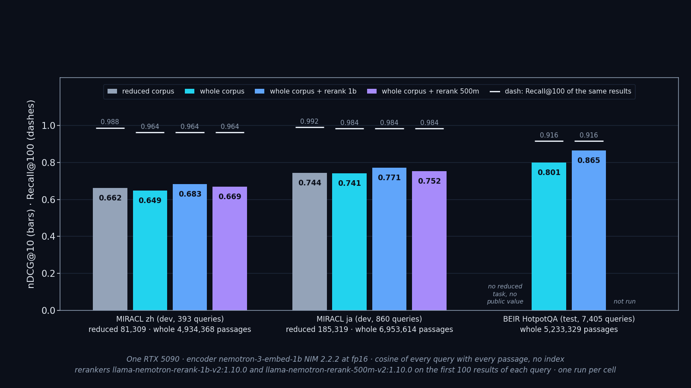
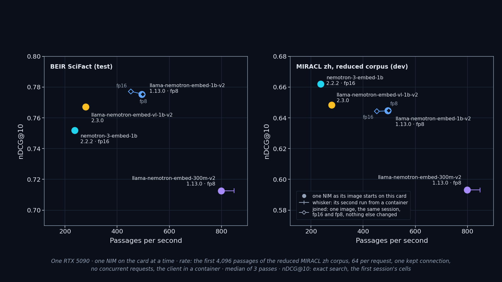

# Vol.4 · NeMo Retriever on one RTX 5090 — tools and the first measurements

**This volume is not yet published.** It holds the tools the volume measures with, the check that shows the metric tool agrees with a published score, the sources that were read first, and every cell of the volume: the first session of 2026-10-04 ([`results/first_batch/`](results/first_batch/README.md)), the second batch, the whole corpora of MIRACL zh and ja and of BEIR HotpotQA with two rerankers, the storage-precision cells, the 16-bit store of the whole-corpus vectors, the concurrency sweep of the embedding and reranking NIMs over two nights, and the load tool's own ceiling. Every number of the forum draft has a row in the second claim table below.

## What is here

| Path | What it is |
|---|---|
| [`scripts/retrieval_datasets.py`](scripts/retrieval_datasets.py) | readers for BEIR SciFact, BEIR HotpotQA, MIRACL zh and ja, and the reduced MIRACL task of MTEB (zh and ja): one interface for corpus, queries and qrels |
| [`scripts/retrieval_metrics.py`](scripts/retrieval_metrics.py) | nDCG@10 and Recall@100 with `pytrec_eval`; every definition that decides a digit is written at the top of the file |
| [`scripts/nim_retrieval_clients.py`](scripts/nim_retrieval_clients.py) | the request bodies for the embedding and reranking NIMs, built from the OpenAPI files NVIDIA publishes |
| [`scripts/mock_nim_server.py`](scripts/mock_nim_server.py) | a stand-in server for the client tests |
| [`scripts/embed_cell.py`](scripts/embed_cell.py), [`scripts/score_run.py`](scripts/score_run.py), [`scripts/rerank_cell.py`](scripts/rerank_cell.py) | one embedding cell (the same program for the open weights and for a NIM), the search and the two metrics (the same for every cell), one reranking cell |
| [`scripts/run_step.py`](scripts/run_step.py), [`client/Dockerfile`](client/Dockerfile) | the steps of a session (gate, container start and stop, the client in a container on the NIM's Docker network) and the client image |
| [`scripts/method_cell.py`](scripts/method_cell.py), [`scripts/mteb_arbiter.py`](scripts/mteb_arbiter.py), [`scripts/first_batch_table.py`](scripts/first_batch_table.py) | the method cell, MTEB itself as the arbiter of the reference arm, the tables from the result files |
| [`scripts/search_whole_corpus.py`](scripts/search_whole_corpus.py), [`scripts/rerank_latency.py`](scripts/rerank_latency.py) | exact search over a corpus stored in pieces, one piece in memory at a time, with the two metrics; the duration of every reranking call |
| [`results/first_batch/`](results/first_batch/README.md) | the first GPU session: pre-registration, run log, results |
| [`results/second_batch/`](results/second_batch/README.md) | the second GPU session: one library version, one precision at a time, every passage of MIRACL zh and ja encoded |
| [`results/whole_corpus_quality/`](results/whole_corpus_quality/README.md) | nDCG@10 and Recall@100 on the whole MIRACL zh and ja corpora beside the reduced-corpus values; the reranker on those results with the duration of every call; four embedding NIMs timed from a container and from the host |
| [`results/hotpotqa_whole_corpus/`](results/hotpotqa_whole_corpus/README.md) | BEIR HotpotQA, every passage (5,233,329) encoded with the same NIM and searched exactly: nDCG@10 and Recall@100 on the test queries, two controls, and the 1b reranker on the results |
| [`figures/`](figures/) | two figures drawn from the result files, each in a light and a dark version, with the table of every drawn value ([below](#figures-and-where-each-number-comes-from)) |
| [`tests/`](tests/) | 87 unit tests (6 more run when the downloaded data sets are present) |
| [`positive_control/`](positive_control/) | the tool check: Pyserini's BM25 on SciFact, scored by our metric program |
| [`MTEB_REFERENCE.md`](MTEB_REFERENCE.md) | the model-level reference: two values from the public MTEB results, and every condition of them with the file it was read from |
| [`SOURCES.md`](SOURCES.md), [`MODEL_CARD_CLAIMS.json`](MODEL_CARD_CLAIMS.json) | what the documentation, the model cards, the MTEB results repository and the issue trackers say, with links and the date they were read |

## Which of these models the RAG Blueprint uses by default

Read from the compose files of the NVIDIA RAG Blueprint at tag `v2.6.2` (commit `f20716d7`); nothing here was measured for this table.

| Role in the Blueprint | Default (file and line in the Blueprint's repository) | Measured in this volume? |
|---|---|---|
| Embedding | `nvidia/llama-nemotron-embed-vl-1b-v2`, image tag `1.12.0` (`deploy/compose/docker-compose-rag-server.yaml` lines 100 to 101; `deploy/compose/nims.yaml` line 70). Dimensions 2048 (line 104) | the model yes, as image tag `2.3.0` (first session; timing in `results/whole_corpus_quality/`, cell E); the default's own tag `1.12.0` was not run |
| Embedding, the text-only alternative the compose file carries as a comment | `nvidia/llama-nemotron-embed-1b-v2`, image tag `1.13.0` (the same file, lines 102 to 103; `nims.yaml` line 40, profile `text-embed`) | yes, this tag |
| Reranking | `nvidia/llama-nemotron-rerank-1b-v2`, image tag `1.10.0`, on by default (`docker-compose-rag-server.yaml` lines 108, 109 and 113; `nims.yaml` line 100) | yes, this tag: first session, and on the whole MIRACL zh and ja corpora (cell D) |
| Retrieval depth | 100 results from the vector search, 10 after reranking (`VECTOR_DB_TOPK`, `APP_RETRIEVER_TOPK`: lines 70 and 161) | cell D reranks the top 100, the same depth |
| Vector store | Elasticsearch, dense search (lines 40 and 45) | no: this volume searches exactly, on the CPU |

- **`nemotron-3-embed-1b`, the model whose whole-corpus quality this volume measures, is not the Blueprint's default embedder** at this tag: its compose files do not name it. The Blueprint's documentation has a section on migrating to it (`docs/change-model.md` lines 415 to 494, image tag `2.2.1`; this volume measured tag `2.2.2`), which says to re-ingest after the switch.
- `llama-nemotron-rerank-500m-v2` (the second reranker cell) is not named there either.
- The Helm values of the same tag give the same two defaults, with the vision-language embedder enabled and the text embedder disabled (`deploy/helm/nvidia-blueprint-rag/values.yaml` lines 191 to 199 and 888 to 942).

## The tool check

Before the metric program scores anything of ours, it has to give the published number on a ranking somebody else made.

| | nDCG@10 | Recall@100 |
|---|---|---|
| Published by Pyserini for BM25 on BEIR SciFact (`pyserini/2cr/beir.yaml`, `bm25-flat`) | 0.6789 | 0.9253 |
| Pyserini's own evaluation of the ranking we produced with its command | 0.6789 | 0.9253 |
| **Our program on that ranking, against the qrels of the BEIR download** | **0.6789** | **0.9253** |
| Control: the qrels given to the wrong queries | 0.0067 | 0.0250 |
| Control: half of the queries removed from the ranking | 0.3401 | 0.4627 |

- The ranking: 300 queries, 294,041 lines, SHA-256 `04cbcf1249e848ea915156359b49b56f6ccce781b01f3e89540eaf3b04859e19`; two runs gave the same bytes. It lists passage ids of a data set and is kept outside the repository.
- How it was made: [`positive_control/run_bm25_scifact.sh`](positive_control/run_bm25_scifact.sh) in the CPU-only image of [`positive_control/Dockerfile`](positive_control/Dockerfile) (Pyserini 2.4.0, Java 21, prebuilt index `beir-v1.0.0-scifact.flat`). No GPU.
- The record with every value and file hash: [`positive_control/bm25_scifact.json`](positive_control/bm25_scifact.json), written by [`positive_control/check_bm25_scifact.py`](positive_control/check_bm25_scifact.py).

This checks the metric program and the qrels reader. It says nothing about a NIM.

## The model-level reference (run on 2026-10-04: ja reproduced, zh not)

The tool check cannot show that a model is asked the right way: the prefix of a query and of a passage, where an over-long input is cut, how the similarity is computed. For that this volume uses two values someone else published for a model whose weights are open: the MTEB results repository's nDCG@10 of `nvidia/Nemotron-3-Embed-1B-BF16` on the task `MIRACLRetrievalHardNegatives`, **0.64244 (zh) and 0.74194 (ja)**.

Two steps: first the open weights on that task with the conditions of the published result, to see whether this harness arrives at the two values; then the NIM of the same model on the same task. [`MTEB_REFERENCE.md`](MTEB_REFERENCE.md) lists the conditions, each with its source, and the ones that are recorded nowhere.

What came out ([`results/first_batch/README.md`](results/first_batch/README.md) §1): on ja this repository's path gives 0.74383, inside the 0.005 set beforehand. On zh it gives 0.66313, which is 0.021 above the published value; MTEB itself (source tag 2.14.3), run in the same environment on the same weights, gives 0.66251. The published zh value is therefore not reproduced by either, the reason is not known, and nothing was tuned to make it fit. The NIM of the same model agrees with the open weights to 0.0011 (zh) and 0.0001 (ja).

On the other data sets of this volume (SciFact, HotpotQA, the full MIRACL corpus in zh and ja) no published per-data-set score of these models exists; results there are reported as measured, without a claim of having reproduced an official score.

<!-- figures and claim table: generated, do not edit by hand -->

## Figures, and where each number comes from

*Working data; nothing here has been published as an article.* Each bar and each point is one cell's own value. The figures and the tables below set values side by side; they state nothing that relates one model to another.

One encoder, three corpora: the reduced corpus where one exists, every passage of the corpus, and the same results after each of two rerankers.



Four embedding NIMs: nDCG@10 on two data sets against passages per second.



*Drawn by [`figures/plot_vol4_figures.py`](figures/plot_vol4_figures.py) from the cells' own result files, in a light and a dark version (SVG and PNG). Every drawn value is listed with its source file and key in [`figures/figure_points.json`](figures/figure_points.json); the script reads every value back from its source on each run.*

- **First figure.** Bars are nDCG@10, the dash above a bar is Recall@100 of the same results. Reranking reorders the first 100 results of a query, so Recall@100 is the same before and after. BEIR HotpotQA has no reduced task and no public value for this model, and the 500m reranker was not run on it.
- **Second figure.** The horizontal position of a NIM is its first run from a container in the timed cell of 2026-10-06; the whisker reaches to its second run. The vertical position is the first session's quality cell of the same image and profile. The passages-per-second sample is Chinese text in both panels: the left panel sets SciFact quality against that same rate. The rate is measured by this volume's own single-connection Python client, including the time it spends parsing each response; the server's own rate, from AIPerf at one request at a time and at saturation, is in the [concurrency sweep](results/concurrency_sweep/README.md).
- **The joined pair** is `llama-nemotron-embed-1b-v2:1.13.0` started twice in the second session, once pinned to fp16 and once as the image selects (fp8); nothing else changed. It is the one place where two points are meant to be read together.
- What the figures do not show: MIRACL ja in the second figure, the reference arm (the open weights), the host-side timings, and the duration of a reranking call. Those are in the tables below and in the result directories.

### Claim → evidence

Every number of this volume that an article may use, with the file it comes from and the key inside that file. Paths are relative to this directory. `Check`: `rounds` (the stored value rounds to the number). In a row with several numbers, they are in the order of the names in braces in the key; `other/file.json::key` reads another file.

**One encoder on the reduced and on the whole corpus, and two rerankers on the whole-corpus results (first figure)**

Encoder `nemotron-3-embed-1b:2.2.2` (NIM, fp16), exact search. A difference is the second value minus the first, each read from its own file.

| In the post | Number | File | Key | Check |
|---|---|---|---|---|
| MIRACL zh, whole corpus: passages · queries scored | 4,934,368 · 393 | `results/whole_corpus_quality/whole_corpus/miracl-zh/score.json` | `{source.passages,metrics.queries_scored}` | rounds |
| MIRACL zh, reduced corpus: passages | 81,309 | `results/first_batch/nim_nemotron-3-embed-1b_auto/miracl-hn-zh/score.json` | `source.passages` | rounds |
| MIRACL zh, reduced corpus: nDCG@10 · Recall@100 | 0.66199 · 0.98789 | `results/first_batch/nim_nemotron-3-embed-1b_auto/miracl-hn-zh/score.json` | `metrics.{ndcg_cut_10,recall_100}` | rounds |
| MIRACL zh, whole corpus: nDCG@10 · Recall@100 | 0.64921 · 0.96419 | `results/whole_corpus_quality/whole_corpus/miracl-zh/score.json` | `metrics.{ndcg_cut_10,recall_100}` | rounds |
| MIRACL zh: nDCG@10, whole corpus minus reduced corpus | −0.0128 | `results/whole_corpus_quality/whole_corpus/miracl-zh/score.json` | `metrics.ndcg_cut_10 - results/first_batch/nim_nemotron-3-embed-1b_auto/miracl-hn-zh/score.json::metrics.ndcg_cut_10` | rounds |
| MIRACL zh: Recall@100, whole corpus minus reduced corpus | −0.0237 | `results/whole_corpus_quality/whole_corpus/miracl-zh/score.json` | `metrics.recall_100 - results/first_batch/nim_nemotron-3-embed-1b_auto/miracl-hn-zh/score.json::metrics.recall_100` | rounds |
| MIRACL zh, whole corpus, after the 1b reranker: nDCG@10 · Recall@100 | 0.68296 · 0.96419 | `results/whole_corpus_quality/rerank_llama-nemotron-rerank-1b-v2/miracl-zh/score_after.json` | `metrics.{ndcg_cut_10,recall_100}` | rounds |
| MIRACL zh: nDCG@10, after the 1b reranker minus before | +0.0338 | `results/whole_corpus_quality/rerank_llama-nemotron-rerank-1b-v2/miracl-zh/score_after.json` | `metrics.ndcg_cut_10 - results/whole_corpus_quality/whole_corpus/miracl-zh/score.json::metrics.ndcg_cut_10` | rounds |
| MIRACL zh, the 1b reranker: one call with 100 passages, pass 1: calls · p50 · p90 · p99 ms | 393.0 · 143.1 · 185.8 · 241.9 | `results/whole_corpus_quality/rerank_llama-nemotron-rerank-1b-v2/miracl-zh/latency_container.json` | `passes[0].call_ms.{calls,p50,p90,p99}` | rounds |
| MIRACL zh, the 1b reranker: pairs per second, pass 1 | 679.4 | `results/whole_corpus_quality/rerank_llama-nemotron-rerank-1b-v2/miracl-zh/latency_container.json` | `passes[0].pairs_per_s` | rounds |
| MIRACL zh, the 1b reranker: one call with 100 passages, pass 2: calls · p50 · p90 · p99 ms | 393.0 · 143.0 · 188.1 · 238.5 | `results/whole_corpus_quality/rerank_llama-nemotron-rerank-1b-v2/miracl-zh/latency_container.json` | `passes[1].call_ms.{calls,p50,p90,p99}` | rounds |
| MIRACL zh, the 1b reranker: pairs per second, pass 2 | 677.7 | `results/whole_corpus_quality/rerank_llama-nemotron-rerank-1b-v2/miracl-zh/latency_container.json` | `passes[1].pairs_per_s` | rounds |
| MIRACL zh, whole corpus, after the 500m reranker: nDCG@10 · Recall@100 | 0.66932 · 0.96419 | `results/whole_corpus_quality/rerank_llama-nemotron-rerank-500m-v2/miracl-zh/score_after.json` | `metrics.{ndcg_cut_10,recall_100}` | rounds |
| MIRACL zh: nDCG@10, after the 500m reranker minus before | +0.0201 | `results/whole_corpus_quality/rerank_llama-nemotron-rerank-500m-v2/miracl-zh/score_after.json` | `metrics.ndcg_cut_10 - results/whole_corpus_quality/whole_corpus/miracl-zh/score.json::metrics.ndcg_cut_10` | rounds |
| MIRACL zh, the 500m reranker: one call with 100 passages, pass 1: calls · p50 · p90 · p99 ms | 393.0 · 84.5 · 111.5 · 139.7 | `results/whole_corpus_quality/rerank_llama-nemotron-rerank-500m-v2/miracl-zh/latency_container.json` | `passes[0].call_ms.{calls,p50,p90,p99}` | rounds |
| MIRACL zh, the 500m reranker: pairs per second, pass 1 | 1,138.9 | `results/whole_corpus_quality/rerank_llama-nemotron-rerank-500m-v2/miracl-zh/latency_container.json` | `passes[0].pairs_per_s` | rounds |
| MIRACL zh, the 500m reranker: one call with 100 passages, pass 2: calls · p50 · p90 · p99 ms | 393.0 · 85.2 · 110.5 · 142.4 | `results/whole_corpus_quality/rerank_llama-nemotron-rerank-500m-v2/miracl-zh/latency_container.json` | `passes[1].call_ms.{calls,p50,p90,p99}` | rounds |
| MIRACL zh, the 500m reranker: pairs per second, pass 2 | 1,136.1 | `results/whole_corpus_quality/rerank_llama-nemotron-rerank-500m-v2/miracl-zh/latency_container.json` | `passes[1].pairs_per_s` | rounds |
| MIRACL ja, whole corpus: passages · queries scored | 6,953,614 · 860 | `results/whole_corpus_quality/whole_corpus/miracl-ja/score.json` | `{source.passages,metrics.queries_scored}` | rounds |
| MIRACL ja, reduced corpus: passages | 185,319 | `results/first_batch/nim_nemotron-3-embed-1b_auto/miracl-hn-ja/score.json` | `source.passages` | rounds |
| MIRACL ja, reduced corpus: nDCG@10 · Recall@100 | 0.74371 · 0.99163 | `results/first_batch/nim_nemotron-3-embed-1b_auto/miracl-hn-ja/score.json` | `metrics.{ndcg_cut_10,recall_100}` | rounds |
| MIRACL ja, whole corpus: nDCG@10 · Recall@100 | 0.74122 · 0.98422 | `results/whole_corpus_quality/whole_corpus/miracl-ja/score.json` | `metrics.{ndcg_cut_10,recall_100}` | rounds |
| MIRACL ja: nDCG@10, whole corpus minus reduced corpus | −0.0025 | `results/whole_corpus_quality/whole_corpus/miracl-ja/score.json` | `metrics.ndcg_cut_10 - results/first_batch/nim_nemotron-3-embed-1b_auto/miracl-hn-ja/score.json::metrics.ndcg_cut_10` | rounds |
| MIRACL ja: Recall@100, whole corpus minus reduced corpus | −0.0074 | `results/whole_corpus_quality/whole_corpus/miracl-ja/score.json` | `metrics.recall_100 - results/first_batch/nim_nemotron-3-embed-1b_auto/miracl-hn-ja/score.json::metrics.recall_100` | rounds |
| MIRACL ja, whole corpus, after the 1b reranker: nDCG@10 · Recall@100 | 0.77134 · 0.98422 | `results/whole_corpus_quality/rerank_llama-nemotron-rerank-1b-v2/miracl-ja/score_after.json` | `metrics.{ndcg_cut_10,recall_100}` | rounds |
| MIRACL ja: nDCG@10, after the 1b reranker minus before | +0.0301 | `results/whole_corpus_quality/rerank_llama-nemotron-rerank-1b-v2/miracl-ja/score_after.json` | `metrics.ndcg_cut_10 - results/whole_corpus_quality/whole_corpus/miracl-ja/score.json::metrics.ndcg_cut_10` | rounds |
| MIRACL ja, the 1b reranker: one call with 100 passages, pass 1: calls · p50 · p90 · p99 ms | 860.0 · 154.1 · 194.4 · 251.9 | `results/whole_corpus_quality/rerank_llama-nemotron-rerank-1b-v2/miracl-ja/latency_container.json` | `passes[0].call_ms.{calls,p50,p90,p99}` | rounds |
| MIRACL ja, the 1b reranker: pairs per second, pass 1 | 638.5 | `results/whole_corpus_quality/rerank_llama-nemotron-rerank-1b-v2/miracl-ja/latency_container.json` | `passes[0].pairs_per_s` | rounds |
| MIRACL ja, the 1b reranker: one call with 100 passages, pass 2: calls · p50 · p90 · p99 ms | 860.0 · 154.1 · 195.3 · 254.3 | `results/whole_corpus_quality/rerank_llama-nemotron-rerank-1b-v2/miracl-ja/latency_container.json` | `passes[1].call_ms.{calls,p50,p90,p99}` | rounds |
| MIRACL ja, the 1b reranker: pairs per second, pass 2 | 636.0 | `results/whole_corpus_quality/rerank_llama-nemotron-rerank-1b-v2/miracl-ja/latency_container.json` | `passes[1].pairs_per_s` | rounds |
| MIRACL ja, whole corpus, after the 500m reranker: nDCG@10 · Recall@100 | 0.75233 · 0.98422 | `results/whole_corpus_quality/rerank_llama-nemotron-rerank-500m-v2/miracl-ja/score_after.json` | `metrics.{ndcg_cut_10,recall_100}` | rounds |
| MIRACL ja: nDCG@10, after the 500m reranker minus before | +0.0111 | `results/whole_corpus_quality/rerank_llama-nemotron-rerank-500m-v2/miracl-ja/score_after.json` | `metrics.ndcg_cut_10 - results/whole_corpus_quality/whole_corpus/miracl-ja/score.json::metrics.ndcg_cut_10` | rounds |
| MIRACL ja, the 500m reranker: one call with 100 passages, pass 1: calls · p50 · p90 · p99 ms | 860.0 · 91.3 · 115.6 · 147.5 | `results/whole_corpus_quality/rerank_llama-nemotron-rerank-500m-v2/miracl-ja/latency_container.json` | `passes[0].call_ms.{calls,p50,p90,p99}` | rounds |
| MIRACL ja, the 500m reranker: pairs per second, pass 1 | 1,073.9 | `results/whole_corpus_quality/rerank_llama-nemotron-rerank-500m-v2/miracl-ja/latency_container.json` | `passes[0].pairs_per_s` | rounds |
| MIRACL ja, the 500m reranker: one call with 100 passages, pass 2: calls · p50 · p90 · p99 ms | 860.0 · 91.6 · 116.0 · 147.5 | `results/whole_corpus_quality/rerank_llama-nemotron-rerank-500m-v2/miracl-ja/latency_container.json` | `passes[1].call_ms.{calls,p50,p90,p99}` | rounds |
| MIRACL ja, the 500m reranker: pairs per second, pass 2 | 1,072.8 | `results/whole_corpus_quality/rerank_llama-nemotron-rerank-500m-v2/miracl-ja/latency_container.json` | `passes[1].pairs_per_s` | rounds |
| BEIR HotpotQA, whole corpus: passages · queries scored | 5,233,329 · 7,405 | `results/hotpotqa_whole_corpus/whole_corpus/beir-hotpotqa/score.json` | `{source.passages,metrics.queries_scored}` | rounds |
| BEIR HotpotQA, whole corpus: nDCG@10 · Recall@100 | 0.80079 · 0.91567 | `results/hotpotqa_whole_corpus/whole_corpus/beir-hotpotqa/score.json` | `metrics.{ndcg_cut_10,recall_100}` | rounds |
| BEIR HotpotQA, whole corpus, after the 1b reranker: nDCG@10 · Recall@100 | 0.86467 · 0.91567 | `results/hotpotqa_whole_corpus/rerank_llama-nemotron-rerank-1b-v2/beir-hotpotqa/score_after.json` | `metrics.{ndcg_cut_10,recall_100}` | rounds |
| BEIR HotpotQA: nDCG@10, after the 1b reranker minus before | +0.0639 | `results/hotpotqa_whole_corpus/rerank_llama-nemotron-rerank-1b-v2/beir-hotpotqa/score_after.json` | `metrics.ndcg_cut_10 - results/hotpotqa_whole_corpus/whole_corpus/beir-hotpotqa/score.json::metrics.ndcg_cut_10` | rounds |
| BEIR HotpotQA, the 1b reranker: one call with 100 passages, pass 1: calls · p50 · p90 · p99 ms | 7,405.0 · 102.6 · 120.9 · 137.0 | `results/hotpotqa_whole_corpus/rerank_llama-nemotron-rerank-1b-v2/beir-hotpotqa/latency_container.json` | `passes[0].call_ms.{calls,p50,p90,p99}` | rounds |
| BEIR HotpotQA, the 1b reranker: pairs per second, pass 1 | 978.0 | `results/hotpotqa_whole_corpus/rerank_llama-nemotron-rerank-1b-v2/beir-hotpotqa/latency_container.json` | `passes[0].pairs_per_s` | rounds |
| BEIR HotpotQA, the 1b reranker: one call with 100 passages, pass 2: calls · p50 · p90 · p99 ms | 7,405.0 · 102.6 · 120.9 · 137.2 | `results/hotpotqa_whole_corpus/rerank_llama-nemotron-rerank-1b-v2/beir-hotpotqa/latency_container.json` | `passes[1].call_ms.{calls,p50,p90,p99}` | rounds |
| BEIR HotpotQA, the 1b reranker: pairs per second, pass 2 | 978.2 | `results/hotpotqa_whole_corpus/rerank_llama-nemotron-rerank-1b-v2/beir-hotpotqa/latency_container.json` | `passes[1].pairs_per_s` | rounds |

**BEIR HotpotQA: the two controls of the whole-corpus figure**

| In the post | Number | File | Key | Check |
|---|---|---|---|---|
| Stored vectors: passages encoded again · ids equal at their position · failed | 1,000 · 1,000 · 0 | `results/hotpotqa_whole_corpus/ids_and_vectors_belong_together/beir-hotpotqa/check.json` | `{sample.passages,ids_equal_at_their_position,failed}` | rounds |
| Stored vectors: cosine of the stored and the new vector, minimum · median | 1.0000000 · 1.0000000 | `results/hotpotqa_whole_corpus/ids_and_vectors_belong_together/beir-hotpotqa/check.json` | `cosine.{min,median}` | rounds |
| Subset searched two ways: passages of the subset · queries | 111,926 · 7,405 | `results/hotpotqa_whole_corpus/subset_two_ways/second_way.json` | `{subset_passages,queries}` | rounds |
| Subset: passages with a judgement · passages of the first piece · in both | 13,783 · 100,000 · 1,857 | `results/hotpotqa_whole_corpus/subset_two_ways/subset.json` | `{passages_with_a_judgement,passages_of_the_first_piece,in_both}` | rounds |
| Subset, first way (the whole-corpus program restricted to the subset): nDCG@10 · Recall@100 | 0.91199 · 0.97698 | `results/hotpotqa_whole_corpus/subset_two_ways/second_way.json` | `first_way.{ndcg_cut_10,recall_100}` | rounds |
| Subset, second way (one matrix product): nDCG@10 · Recall@100 | 0.91199 · 0.97698 | `results/hotpotqa_whole_corpus/subset_two_ways/second_way.json` | `second_way.{ndcg_cut_10,recall_100}` | rounds |
| Subset: queries whose two values are equal in both ways · queries compared | 7,405 · 7,405 | `results/hotpotqa_whole_corpus/subset_two_ways/second_way.json` | `{queries_whose_two_values_are_equal_in_both_ways,queries_compared}` | rounds |

**Four embedding NIMs: quality in the first session, passages per second in the timed cell (second figure)**

Passages per second: the first 4,096 passages of the reduced MIRACL zh corpus, 64 per request, one kept connection, median of three passes; measured by this volume's own single-connection Python client, including the time it spends parsing each response; the server's own rate, from AIPerf at one request at a time and at saturation, is in the [concurrency sweep](results/concurrency_sweep/README.md).

| In the post | Number | File | Key | Check |
|---|---|---|---|---|
| nemotron-3-embed-1b 2.2.2 (fp16) · BEIR SciFact: nDCG@10 · Recall@100 | 0.75188 · 0.95667 | `results/first_batch/nim_nemotron-3-embed-1b_auto/beir-scifact/score.json` | `metrics.{ndcg_cut_10,recall_100}` | rounds |
| nemotron-3-embed-1b 2.2.2 (fp16) · MIRACL zh, reduced: nDCG@10 · Recall@100 | 0.66199 · 0.98789 | `results/first_batch/nim_nemotron-3-embed-1b_auto/miracl-hn-zh/score.json` | `metrics.{ndcg_cut_10,recall_100}` | rounds |
| nemotron-3-embed-1b 2.2.2 (fp16) · MIRACL ja, reduced: nDCG@10 · Recall@100 | 0.74371 · 0.99163 | `results/first_batch/nim_nemotron-3-embed-1b_auto/miracl-hn-ja/score.json` | `metrics.{ndcg_cut_10,recall_100}` | rounds |
| nemotron-3-embed-1b 2.2.2 (fp16): passages per second, client in a container, first run | 237.6 | `results/whole_corpus_quality/timing_container_and_host/n3embed/container_1.json` | `passages_per_s_median` | rounds |
| nemotron-3-embed-1b 2.2.2 (fp16): the same, client on the host | 227.4 | `results/whole_corpus_quality/timing_container_and_host/n3embed/host.json` | `passages_per_s_median` | rounds |
| nemotron-3-embed-1b 2.2.2 (fp16): the same, client in a container, second run | 233.0 | `results/whole_corpus_quality/timing_container_and_host/n3embed/container_2.json` | `passages_per_s_median` | rounds |
| nemotron-3-embed-1b 2.2.2 (fp16): host against the mean of the two container runs, % | −3.4 | `results/whole_corpus_quality/timing_container_and_host/n3embed/host.json` | `(passages_per_s_median / ((results/whole_corpus_quality/timing_container_and_host/n3embed/container_1.json::passages_per_s_median + results/whole_corpus_quality/timing_container_and_host/n3embed/container_2.json::passages_per_s_median) / 2) - 1) * 100` | rounds |
| nemotron-3-embed-1b 2.2.2 (fp16): passages per second in the first session (2026-10-04), client in a container | 243.7 | `results/first_batch/nim_nemotron-3-embed-1b_auto/miracl-hn-zh/throughput.json` | `passages_per_s_median` | rounds |
| llama-nemotron-embed-vl-1b-v2 2.3.0 · BEIR SciFact: nDCG@10 · Recall@100 | 0.76704 · 0.96667 | `results/first_batch/nim_llama-nemotron-embed-vl-1b-v2_auto/beir-scifact/score.json` | `metrics.{ndcg_cut_10,recall_100}` | rounds |
| llama-nemotron-embed-vl-1b-v2 2.3.0 · MIRACL zh, reduced: nDCG@10 · Recall@100 | 0.64837 · 0.98127 | `results/first_batch/nim_llama-nemotron-embed-vl-1b-v2_auto/miracl-hn-zh/score.json` | `metrics.{ndcg_cut_10,recall_100}` | rounds |
| llama-nemotron-embed-vl-1b-v2 2.3.0 · MIRACL ja, reduced: nDCG@10 · Recall@100 | 0.71875 · 0.98708 | `results/first_batch/nim_llama-nemotron-embed-vl-1b-v2_auto/miracl-hn-ja/score.json` | `metrics.{ndcg_cut_10,recall_100}` | rounds |
| llama-nemotron-embed-vl-1b-v2 2.3.0: passages per second, client in a container, first run | 278.7 | `results/whole_corpus_quality/timing_container_and_host/embedvl/container_1.json` | `passages_per_s_median` | rounds |
| llama-nemotron-embed-vl-1b-v2 2.3.0: the same, client on the host | 267.1 | `results/whole_corpus_quality/timing_container_and_host/embedvl/host.json` | `passages_per_s_median` | rounds |
| llama-nemotron-embed-vl-1b-v2 2.3.0: the same, client in a container, second run | 277.7 | `results/whole_corpus_quality/timing_container_and_host/embedvl/container_2.json` | `passages_per_s_median` | rounds |
| llama-nemotron-embed-vl-1b-v2 2.3.0: host against the mean of the two container runs, % | −4.0 | `results/whole_corpus_quality/timing_container_and_host/embedvl/host.json` | `(passages_per_s_median / ((results/whole_corpus_quality/timing_container_and_host/embedvl/container_1.json::passages_per_s_median + results/whole_corpus_quality/timing_container_and_host/embedvl/container_2.json::passages_per_s_median) / 2) - 1) * 100` | rounds |
| llama-nemotron-embed-vl-1b-v2 2.3.0: passages per second in the first session (2026-10-04), client in a container | 279.7 | `results/first_batch/nim_llama-nemotron-embed-vl-1b-v2_auto/miracl-hn-zh/throughput.json` | `passages_per_s_median` | rounds |
| llama-nemotron-embed-1b-v2 1.13.0 (fp8, selected by the image) · BEIR SciFact: nDCG@10 · Recall@100 | 0.77537 · 0.96333 | `results/first_batch/nim_llama-nemotron-embed-1b-v2_auto/beir-scifact/score.json` | `metrics.{ndcg_cut_10,recall_100}` | rounds |
| llama-nemotron-embed-1b-v2 1.13.0 (fp8, selected by the image) · MIRACL zh, reduced: nDCG@10 · Recall@100 | 0.64458 · 0.98326 | `results/first_batch/nim_llama-nemotron-embed-1b-v2_auto/miracl-hn-zh/score.json` | `metrics.{ndcg_cut_10,recall_100}` | rounds |
| llama-nemotron-embed-1b-v2 1.13.0 (fp8, selected by the image) · MIRACL ja, reduced: nDCG@10 · Recall@100 | 0.71579 · 0.98450 | `results/first_batch/nim_llama-nemotron-embed-1b-v2_auto/miracl-hn-ja/score.json` | `metrics.{ndcg_cut_10,recall_100}` | rounds |
| llama-nemotron-embed-1b-v2 1.13.0 (fp8, selected by the image): passages per second, client in a container, first run | 495.0 | `results/whole_corpus_quality/timing_container_and_host/embed1bv2/container_1.json` | `passages_per_s_median` | rounds |
| llama-nemotron-embed-1b-v2 1.13.0 (fp8, selected by the image): the same, client on the host | 445.7 | `results/whole_corpus_quality/timing_container_and_host/embed1bv2/host.json` | `passages_per_s_median` | rounds |
| llama-nemotron-embed-1b-v2 1.13.0 (fp8, selected by the image): the same, client in a container, second run | 492.6 | `results/whole_corpus_quality/timing_container_and_host/embed1bv2/container_2.json` | `passages_per_s_median` | rounds |
| llama-nemotron-embed-1b-v2 1.13.0 (fp8, selected by the image): host against the mean of the two container runs, % | −9.7 | `results/whole_corpus_quality/timing_container_and_host/embed1bv2/host.json` | `(passages_per_s_median / ((results/whole_corpus_quality/timing_container_and_host/embed1bv2/container_1.json::passages_per_s_median + results/whole_corpus_quality/timing_container_and_host/embed1bv2/container_2.json::passages_per_s_median) / 2) - 1) * 100` | rounds |
| llama-nemotron-embed-1b-v2 1.13.0 (fp8, selected by the image): passages per second in the first session (2026-10-04), client in a container | 485.6 | `results/first_batch/nim_llama-nemotron-embed-1b-v2_auto/miracl-hn-zh/throughput.json` | `passages_per_s_median` | rounds |
| llama-nemotron-embed-300m-v2 1.13.0 (fp8, selected by the image) · BEIR SciFact: nDCG@10 · Recall@100 | 0.71259 · 0.95000 | `results/first_batch/nim_llama-nemotron-embed-300m-v2_auto/beir-scifact/score.json` | `metrics.{ndcg_cut_10,recall_100}` | rounds |
| llama-nemotron-embed-300m-v2 1.13.0 (fp8, selected by the image) · MIRACL zh, reduced: nDCG@10 · Recall@100 | 0.59313 · 0.97396 | `results/first_batch/nim_llama-nemotron-embed-300m-v2_auto/miracl-hn-zh/score.json` | `metrics.{ndcg_cut_10,recall_100}` | rounds |
| llama-nemotron-embed-300m-v2 1.13.0 (fp8, selected by the image) · MIRACL ja, reduced: nDCG@10 · Recall@100 | 0.67644 · 0.96605 | `results/first_batch/nim_llama-nemotron-embed-300m-v2_auto/miracl-hn-ja/score.json` | `metrics.{ndcg_cut_10,recall_100}` | rounds |
| llama-nemotron-embed-300m-v2 1.13.0 (fp8, selected by the image): passages per second, client in a container, first run | 798.6 | `results/whole_corpus_quality/timing_container_and_host/embed300m/container_1.json` | `passages_per_s_median` | rounds |
| llama-nemotron-embed-300m-v2 1.13.0 (fp8, selected by the image): the same, client on the host | 717.1 | `results/whole_corpus_quality/timing_container_and_host/embed300m/host.json` | `passages_per_s_median` | rounds |
| llama-nemotron-embed-300m-v2 1.13.0 (fp8, selected by the image): the same, client in a container, second run | 848.3 | `results/whole_corpus_quality/timing_container_and_host/embed300m/container_2.json` | `passages_per_s_median` | rounds |
| llama-nemotron-embed-300m-v2 1.13.0 (fp8, selected by the image): host against the mean of the two container runs, % | −12.9 | `results/whole_corpus_quality/timing_container_and_host/embed300m/host.json` | `(passages_per_s_median / ((results/whole_corpus_quality/timing_container_and_host/embed300m/container_1.json::passages_per_s_median + results/whole_corpus_quality/timing_container_and_host/embed300m/container_2.json::passages_per_s_median) / 2) - 1) * 100` | rounds |
| llama-nemotron-embed-300m-v2 1.13.0 (fp8, selected by the image): passages per second in the first session (2026-10-04), client in a container | 796.0 | `results/first_batch/nim_llama-nemotron-embed-300m-v2_auto/miracl-hn-zh/throughput.json` | `passages_per_s_median` | rounds |

**One NIM image, the same session, two precisions (the joined pair of the second figure)**

`llama-nemotron-embed-1b-v2:1.13.0` in the second session. The fp8 start of that session was timed and not scored; the fp8 quality is the first session's cell above (the same profile).

| In the post | Number | File | Key | Check |
|---|---|---|---|---|
| fp16 · BEIR SciFact: nDCG@10 · Recall@100 | 0.77718 · 0.96333 | `results/second_batch/nim_llama-nemotron-embed-1b-v2_fp16/beir-scifact/score.json` | `metrics.{ndcg_cut_10,recall_100}` | rounds |
| BEIR SciFact: nDCG@10, fp8 minus fp16 | −0.00181 | `results/first_batch/nim_llama-nemotron-embed-1b-v2_auto/beir-scifact/score.json` | `metrics.ndcg_cut_10 - results/second_batch/nim_llama-nemotron-embed-1b-v2_fp16/beir-scifact/score.json::metrics.ndcg_cut_10` | rounds |
| fp16 · passages per second on the sample of BEIR SciFact | 219.8 | `results/second_batch/nim_llama-nemotron-embed-1b-v2_fp16/beir-scifact/throughput.json` | `passages_per_s_median` | rounds |
| fp8, the same night · passages per second on the sample of BEIR SciFact | 258.4 | `results/second_batch/nim_llama-nemotron-embed-1b-v2_auto_same_night/beir-scifact/throughput.json` | `passages_per_s_median` | rounds |
| fp16 · MIRACL zh, reduced: nDCG@10 · Recall@100 | 0.64420 · 0.98207 | `results/second_batch/nim_llama-nemotron-embed-1b-v2_fp16/miracl-hn-zh/score.json` | `metrics.{ndcg_cut_10,recall_100}` | rounds |
| MIRACL zh, reduced: nDCG@10, fp8 minus fp16 | +0.00038 | `results/first_batch/nim_llama-nemotron-embed-1b-v2_auto/miracl-hn-zh/score.json` | `metrics.ndcg_cut_10 - results/second_batch/nim_llama-nemotron-embed-1b-v2_fp16/miracl-hn-zh/score.json::metrics.ndcg_cut_10` | rounds |
| fp16 · passages per second on the sample of MIRACL zh, reduced | 452.4 | `results/second_batch/nim_llama-nemotron-embed-1b-v2_fp16/miracl-hn-zh/throughput.json` | `passages_per_s_median` | rounds |
| fp8, the same night · passages per second on the sample of MIRACL zh, reduced | 498.4 | `results/second_batch/nim_llama-nemotron-embed-1b-v2_auto_same_night/miracl-hn-zh/throughput.json` | `passages_per_s_median` | rounds |
| fp16 · MIRACL ja, reduced: nDCG@10 · Recall@100 | 0.71997 · 0.98620 | `results/second_batch/nim_llama-nemotron-embed-1b-v2_fp16/miracl-hn-ja/score.json` | `metrics.{ndcg_cut_10,recall_100}` | rounds |
| MIRACL ja, reduced: nDCG@10, fp8 minus fp16 | −0.00418 | `results/first_batch/nim_llama-nemotron-embed-1b-v2_auto/miracl-hn-ja/score.json` | `metrics.ndcg_cut_10 - results/second_batch/nim_llama-nemotron-embed-1b-v2_fp16/miracl-hn-ja/score.json::metrics.ndcg_cut_10` | rounds |
| fp16 · passages per second on the sample of MIRACL ja, reduced | 383.9 | `results/second_batch/nim_llama-nemotron-embed-1b-v2_fp16/miracl-hn-ja/throughput.json` | `passages_per_s_median` | rounds |
| fp8, the same night · passages per second on the sample of MIRACL ja, reduced | 434.8 | `results/second_batch/nim_llama-nemotron-embed-1b-v2_auto_same_night/miracl-hn-ja/throughput.json` | `passages_per_s_median` | rounds |

**The reference arm (the open weights), the public MTEB values, and the tool check**

| In the post | Number | File | Key | Check |
|---|---|---|---|---|
| Reference arm · MIRACL zh, reduced: nDCG@10 · Recall@100 | 0.66313 · 0.98789 | `results/first_batch/reference_bf16/miracl-hn-zh/score.json` | `metrics.{ndcg_cut_10,recall_100}` | rounds |
| Reference arm · MIRACL ja, reduced: nDCG@10 · Recall@100 | 0.74383 · 0.99202 | `results/first_batch/reference_bf16/miracl-hn-ja/score.json` | `metrics.{ndcg_cut_10,recall_100}` | rounds |
| Reference arm · passages per second on the MIRACL zh sample (64 per batch) | 368.7 | `results/first_batch/reference_bf16/miracl-hn-zh/throughput.json` | `passages_per_s_median` | rounds |
| Reference arm · passages per second on the MIRACL ja sample (16 per batch) | 290.6 | `results/whole_corpus_quality/reference_bf16_batch16/miracl-hn-ja/throughput.json` | `passages_per_s_median` | rounds |
| MTEB itself on the reference arm, MIRACL zh (reduced): nDCG@10 · Recall@100 | 0.66251 · 0.98789 | `results/first_batch/reference_bf16/mteb_arbiter/zh.json` | `scores.{ndcg_at_10,recall_at_100}` | rounds |
| Public MTEB result of the open weights, MIRACL zh (reduced): nDCG@10 | 0.64244 | `MODEL_CARD_CLAIMS.json` | `mteb_results.models[5].files_that_touch_scifact_hotpotqa_or_miracl.MIRACLRetrievalHardNegatives.json.zh.ndcg_at_10` | rounds |
| Public MTEB result of the open weights, MIRACL ja (reduced): nDCG@10 | 0.74194 | `MODEL_CARD_CLAIMS.json` | `mteb_results.models[5].files_that_touch_scifact_hotpotqa_or_miracl.MIRACLRetrievalHardNegatives.json.ja.ndcg_at_10` | rounds |
| Tool check, BM25 on SciFact as published by Pyserini: nDCG@10 · Recall@100 | 0.6789 · 0.9253 | `positive_control/bm25_scifact.json` | `published.{nDCG@10,R@100}` | rounds |
| Tool check, the same ranking scored by our metric program: nDCG@10 · Recall@100 | 0.6789 · 0.9253 | `positive_control/bm25_scifact.json` | `ours.{nDCG@10,R@100}` | rounds |

**How to check a row:** open the file, follow the key, compare. Or check every row at once: `python ../tools/check_claims.py README.md` (from this directory).

<!-- end of the figures and claim table -->

<!-- forum post claims: generated, do not edit by hand -->

### Claim → evidence: the forum post

Every number of the forum post that the tables above do not already hold. Rows marked `text` point to the sentence or log line that states the fact; `equals` rows are counts or levels.

**Title and corpora**

| In the post | Number | File | Key | Check |
|---|---|---|---|---|
| Title: MIRACL zh, whole corpus, millions of passages | 4.9 | `results/whole_corpus_quality/whole_corpus/miracl-zh/score.json` | `source.passages / 1000000` | rounds |
| Title: MIRACL ja, whole corpus, millions of passages | 7.0 | `results/whole_corpus_quality/whole_corpus/miracl-ja/score.json` | `source.passages / 1000000` | rounds |

**Rerank the top 100**

| In the post | Number | File | Key | Check |
|---|---|---|---|---|
| MIRACL zh: nDCG@10 gained by the 1b reranker (whole corpus) | 0.034 | `results/whole_corpus_quality/rerank_llama-nemotron-rerank-1b-v2/miracl-zh/score_after.json` | `metrics.ndcg_cut_10 - results/whole_corpus_quality/whole_corpus/miracl-zh/score.json::metrics.ndcg_cut_10` | rounds |
| MIRACL ja: nDCG@10 gained by the 1b reranker: the low end of '0.030 to 0.064' | 0.030 | `results/whole_corpus_quality/rerank_llama-nemotron-rerank-1b-v2/miracl-ja/score_after.json` | `metrics.ndcg_cut_10 - results/whole_corpus_quality/whole_corpus/miracl-ja/score.json::metrics.ndcg_cut_10` | rounds |
| BEIR HotpotQA: nDCG@10 gained by the 1b reranker: the high end of '0.030 to 0.064' | 0.064 | `results/hotpotqa_whole_corpus/rerank_llama-nemotron-rerank-1b-v2/beir-hotpotqa/score_after.json` | `metrics.ndcg_cut_10 - results/hotpotqa_whole_corpus/whole_corpus/beir-hotpotqa/score.json::metrics.ndcg_cut_10` | rounds |
| MIRACL zh: nDCG@10 gained by the 500m reranker | 0.020 | `results/whole_corpus_quality/rerank_llama-nemotron-rerank-500m-v2/miracl-zh/score_after.json` | `metrics.ndcg_cut_10 - results/whole_corpus_quality/whole_corpus/miracl-zh/score.json::metrics.ndcg_cut_10` | rounds |
| MIRACL ja: nDCG@10 gained by the 500m reranker | 0.011 | `results/whole_corpus_quality/rerank_llama-nemotron-rerank-500m-v2/miracl-ja/score_after.json` | `metrics.ndcg_cut_10 - results/whole_corpus_quality/whole_corpus/miracl-ja/score.json::metrics.ndcg_cut_10` | rounds |
| The 500m reranker's gain as a share of the 1b reranker's, MIRACL ja, %: the low end of '37–60%' | 37 | `results/whole_corpus_quality/rerank_llama-nemotron-rerank-500m-v2/miracl-ja/score_after.json` | `(metrics.ndcg_cut_10 - results/whole_corpus_quality/whole_corpus/miracl-ja/score.json::metrics.ndcg_cut_10) / (results/whole_corpus_quality/rerank_llama-nemotron-rerank-1b-v2/miracl-ja/score_after.json::metrics.ndcg_cut_10 - results/whole_corpus_quality/whole_corpus/miracl-ja/score.json::metrics.ndcg_cut_10) * 100` | rounds |
| The same, MIRACL zh, %: the high end of '37–60%' | 60 | `results/whole_corpus_quality/rerank_llama-nemotron-rerank-500m-v2/miracl-zh/score_after.json` | `(metrics.ndcg_cut_10 - results/whole_corpus_quality/whole_corpus/miracl-zh/score.json::metrics.ndcg_cut_10) / (results/whole_corpus_quality/rerank_llama-nemotron-rerank-1b-v2/miracl-zh/score_after.json::metrics.ndcg_cut_10 - results/whole_corpus_quality/whole_corpus/miracl-zh/score.json::metrics.ndcg_cut_10) * 100` | rounds |
| Median duration of one call with 100 passages, 500m against 1b reranker, MIRACL zh, %: 'about 60% of the time' | 59 | `results/whole_corpus_quality/rerank_llama-nemotron-rerank-500m-v2/miracl-zh/latency_container.json` | `passes[0].call_ms.p50 / results/whole_corpus_quality/rerank_llama-nemotron-rerank-1b-v2/miracl-zh/latency_container.json::passes[0].call_ms.p50 * 100` | approx |
| The same, MIRACL ja, % | 59 | `results/whole_corpus_quality/rerank_llama-nemotron-rerank-500m-v2/miracl-ja/latency_container.json` | `passes[0].call_ms.p50 / results/whole_corpus_quality/rerank_llama-nemotron-rerank-1b-v2/miracl-ja/latency_container.json::passes[0].call_ms.p50 * 100` | approx |
| Median duration of one call with 100 passages, 1b reranker, MIRACL zh, ms | 143 | `results/whole_corpus_quality/rerank_llama-nemotron-rerank-1b-v2/miracl-zh/latency_container.json` | `passes[0].call_ms.p50` | rounds |
| The same, 500m reranker, MIRACL zh, ms | 85 | `results/whole_corpus_quality/rerank_llama-nemotron-rerank-500m-v2/miracl-zh/latency_container.json` | `passes[0].call_ms.p50` | rounds |
| The same, 1b reranker, BEIR HotpotQA, ms: the low end of '103–154 ms' | 103 | `results/hotpotqa_whole_corpus/rerank_llama-nemotron-rerank-1b-v2/beir-hotpotqa/latency_container.json` | `passes[0].call_ms.p50` | rounds |
| The same, 1b reranker, MIRACL ja, ms: the high end of '103–154 ms' | 154 | `results/whole_corpus_quality/rerank_llama-nemotron-rerank-1b-v2/miracl-ja/latency_container.json` | `passes[0].call_ms.p50` | rounds |
| MIRACL zh, reduced against whole corpus: nDCG@10 lost | 0.013 | `results/first_batch/nim_nemotron-3-embed-1b_auto/miracl-hn-zh/score.json` | `metrics.ndcg_cut_10 - results/whole_corpus_quality/whole_corpus/miracl-zh/score.json::metrics.ndcg_cut_10` | rounds |
| The same, Recall@100 lost | 0.024 | `results/first_batch/nim_nemotron-3-embed-1b_auto/miracl-hn-zh/score.json` | `metrics.recall_100 - results/whole_corpus_quality/whole_corpus/miracl-zh/score.json::metrics.recall_100` | rounds |

**How many requests at once (AIPerf, first container; the 300m NIM on the second night)**

| In the post | Number | File | Key | Check |
|---|---|---|---|---|
| The 500m reranker's pairs per second at one request at a time, over the 1b reranker's (100 passages) | 1.6 | `results/concurrency_sweep/rr500/passages_100/first_c1.json` | `items_per_s / results/concurrency_sweep/rr1b/passages_100/first_c1.json::items_per_s` | rounds |
| nemotron-3-embed-1b, 1 query: requests/s at one request at a time | 269 | `results/concurrency_sweep/table.json` | `arms.n3.shapes.query.first_container.1.requests_per_s` | rounds |
| nemotron-3-embed-1b, 1 query: highest requests/s | 384 | `results/concurrency_sweep/table.json` | `arms.n3.shapes.query.reading_first_container.highest_requests_per_s` | rounds |
| nemotron-3-embed-1b, 1 query: level where the rate stops rising | 2 | `results/concurrency_sweep/table.json` | `arms.n3.shapes.query.reading_first_container.saturation_level` | equals |
| nemotron-3-embed-1b, 64 passages: passages/s at one request at a time | 252 | `results/concurrency_sweep/table.json` | `arms.n3.shapes.passage.first_container.1.items_per_s` | rounds |
| nemotron-3-embed-1b, 64 passages: highest passages/s | 272 | `results/concurrency_sweep/table.json` | `arms.n3.shapes.passage.reading_first_container.highest_items_per_s` | rounds |
| nemotron-3-embed-1b, 64 passages: level where the rate stops rising | 2 | `results/concurrency_sweep/table.json` | `arms.n3.shapes.passage.reading_first_container.saturation_level` | equals |
| llama-nemotron-embed-vl-1b-v2, 1 query: requests/s at one request at a time | 293 | `results/concurrency_sweep/table.json` | `arms.evl.shapes.query.first_container.1.requests_per_s` | rounds |
| llama-nemotron-embed-vl-1b-v2, 1 query: highest requests/s | 419 | `results/concurrency_sweep/table.json` | `arms.evl.shapes.query.reading_first_container.highest_requests_per_s` | rounds |
| llama-nemotron-embed-vl-1b-v2, 1 query: level where the rate stops rising | 2 | `results/concurrency_sweep/table.json` | `arms.evl.shapes.query.reading_first_container.saturation_level` | equals |
| llama-nemotron-embed-1b-v2, 64 passages: passages/s at one request at a time | 594 | `results/concurrency_sweep/table.json` | `arms.e1b.shapes.passage.first_container.1.items_per_s` | rounds |
| llama-nemotron-embed-1b-v2, 64 passages: highest passages/s | 796 | `results/concurrency_sweep/table.json` | `arms.e1b.shapes.passage.reading_first_container.highest_items_per_s` | rounds |
| llama-nemotron-embed-1b-v2, 64 passages: level where the rate stops rising | 2 | `results/concurrency_sweep/table.json` | `arms.e1b.shapes.passage.reading_first_container.saturation_level` | equals |
| llama-nemotron-embed-300m-v2, 1 query: requests/s at one request at a time (second night) | 170 | `results/concurrency_sweep_second_night/table.json` | `arms.e300.shapes.query.first_container.1.requests_per_s` | rounds |
| llama-nemotron-embed-300m-v2, 1 query: highest requests/s (second night) | 417 | `results/concurrency_sweep_second_night/table.json` | `arms.e300.shapes.query.reading_first_container.highest_requests_per_s` | rounds |
| llama-nemotron-embed-300m-v2, 1 query: level where the rate stops rising (second night) | 8 | `results/concurrency_sweep_second_night/table.json` | `arms.e300.shapes.query.reading_first_container.saturation_level` | equals |
| llama-nemotron-embed-300m-v2, 64 passages: passages/s at one request at a time (second night) | 1,073 | `results/concurrency_sweep_second_night/table.json` | `arms.e300.shapes.passage.first_container.1.items_per_s` | rounds |
| llama-nemotron-embed-300m-v2, 64 passages: highest passages/s (second night) | 2,138 | `results/concurrency_sweep_second_night/table.json` | `arms.e300.shapes.passage.reading_first_container.highest_items_per_s` | rounds |
| llama-nemotron-embed-300m-v2, 64 passages: level where the rate stops rising (second night) | 4 | `results/concurrency_sweep_second_night/table.json` | `arms.e300.shapes.passage.reading_first_container.saturation_level` | equals |
| llama-nemotron-rerank-1b-v2, 100 passages: pairs/s at one request at a time | 678 | `results/concurrency_sweep/table.json` | `arms.rr1b.shapes.passages_100.first_container.1.items_per_s` | rounds |
| llama-nemotron-rerank-1b-v2, 100 passages: highest pairs/s | 983 | `results/concurrency_sweep/table.json` | `arms.rr1b.shapes.passages_100.reading_first_container.highest_items_per_s` | rounds |
| llama-nemotron-rerank-1b-v2, 100 passages: level where the rate stops rising | 16 | `results/concurrency_sweep/table.json` | `arms.rr1b.shapes.passages_100.reading_first_container.saturation_level` | equals |
| llama-nemotron-rerank-1b-v2, 100 passages: highest requests (queries) per second, 'about 10' | 10 | `results/concurrency_sweep/table.json` | `arms.rr1b.shapes.passages_100.reading_first_container.highest_requests_per_s` | rounds |
| llama-nemotron-rerank-500m-v2, 100 passages: pairs/s at one request at a time | 1,113 | `results/concurrency_sweep/table.json` | `arms.rr500.shapes.passages_100.first_container.1.items_per_s` | rounds |
| llama-nemotron-rerank-500m-v2, 100 passages: highest pairs/s | 1,913 | `results/concurrency_sweep/table.json` | `arms.rr500.shapes.passages_100.reading_first_container.highest_items_per_s` | rounds |
| llama-nemotron-rerank-500m-v2, 100 passages: level where the rate stops rising | 8 | `results/concurrency_sweep/table.json` | `arms.rr500.shapes.passages_100.reading_first_container.saturation_level` | equals |
| llama-nemotron-rerank-500m-v2, 100 passages: highest requests (queries) per second, 'about 19' | 19 | `results/concurrency_sweep/table.json` | `arms.rr500.shapes.passages_100.reading_first_container.highest_requests_per_s` | rounds |
| nemotron-3-embed-1b, 1 query: highest level with a p99 of at most 100 ms (first container) | 32 | `results/concurrency_sweep/table.json` | `arms.n3.shapes.query.reading_first_container.highest_level_with_p99_at_most_100_ms` | equals |
| The same at 32 in flight in the second container: p99 under 100 ms | 100 | `results/concurrency_sweep/table.json` | `arms.n3.shapes.query.second_container.32.request_ms.p99` | within |
| Where the rate 'stops rising': the lowest level at 95% of the highest rate (the rule as pre-registered) | 95% | `results/concurrency_sweep/prediction_concurrency_sweep.json` | `at least 95% of the highest rate` | text |
| The reply: levels from 1 to 64 concurrent requests | 64 | `results/concurrency_sweep/prediction_concurrency_sweep.json` | `N1_concurrency_sweep.load.levels[6]` | equals |

**Two nights, and the load tool's own ceiling**

| In the post | Number | File | Key | Check |
|---|---|---|---|---|
| Levels run on both nights with the same request bodies and without errors | 19 | `results/sweep_summary/summary.json` | `two_nights.levels_on_both_nights_same_bodies_no_errors` | equals |
| The largest difference of the second night's rate from the first's, % ('within 2.1%') | 2.1 | `results/sweep_summary/summary.json` | `two_nights.largest_rate_difference_percent` | within |
| The load tool against a server that answers at once: the smallest room over every level and shape (one query, 1 in flight) | 2.99 | `results/tool_ceiling/table.json` | `shapes.query.lowest_room` | rounds |
| The tool's ceiling, two runs: the largest difference between them, % | 58 | `results/sweep_summary/summary.json` | `tool_ceiling.largest_difference_of_the_two_runs_percent` | rounds |
| This volume's own client against AIPerf at one request at a time: how much less the own client measured, the most over the embedding NIMs, % ('up to 26% less'; llama-nemotron-embed-300m-v2, first night) | 26 | `results/concurrency_sweep/e300/calibration.json` | `difference_percent / (100 + difference_percent) * 100` | rounds |

**Storing the vectors**

| In the post | Number | File | Key | Check |
|---|---|---|---|---|
| The three whole-corpus vector sets as 32-bit files, GB | 140 | `results/fp16_store/summary.json` | `total.bytes_of_the_32_bit_files / 1000000000` | rounds |
| The same as 16-bit files, GB | 70 | `results/fp16_store/summary.json` | `total.bytes_of_the_16_bit_files / 1000000000` | rounds |
| Vectors in the three stores, millions | 17 | `results/fp16_store/summary.json` | `total.passages / 1000000` | rounds |
| Pieces whose every value is equal after the 16-bit round trip, read back from disk (of all pieces) | 174 | `results/fp16_store/summary.json` | `total.pieces_with_every_value_equal_read_back_from_disk` | equals |
| All pieces | 174 | `results/fp16_store/summary.json` | `total.pieces` | equals |
| Queries with the same 100 passages in the same order, searched over the 16-bit stores (of all queries) | 8,658 | `results/fp16_store/summary.json` | `total.queries_with_the_same_passages_in_the_same_order` | rounds |
| int8 store: queries whose first 10 are the same in the same order, BEIR HotpotQA, %: the low end of '33–58%' | 33 | `results/storage_precision/whole_corpus/beir-hotpotqa/int8/score.json` | `against_the_32_bit_ranking.queries_whose_first_10_are_the_same_in_the_same_order / against_the_32_bit_ranking.queries * 100` | rounds |
| The same, MIRACL ja, %: the high end | 58 | `results/storage_precision/whole_corpus/miracl-ja/int8/score.json` | `against_the_32_bit_ranking.queries_whose_first_10_are_the_same_in_the_same_order / against_the_32_bit_ranking.queries * 100` | rounds |

**The NIM and the open weights; what did not run**

| In the post | Number | File | Key | Check |
|---|---|---|---|---|
| MIRACL zh (reduced): nDCG@10 of the open weights minus the NIM's | 0.0011 | `results/first_batch/reference_bf16/miracl-hn-zh/score.json` | `metrics.ndcg_cut_10 - results/first_batch/nim_nemotron-3-embed-1b_auto/miracl-hn-zh/score.json::metrics.ndcg_cut_10` | rounds |
| MIRACL ja (reduced): the same | 0.0001 | `results/first_batch/reference_bf16/miracl-hn-ja/score.json` | `metrics.ndcg_cut_10 - results/first_batch/nim_nemotron-3-embed-1b_auto/miracl-hn-ja/score.json::metrics.ndcg_cut_10` | rounds |
| MIRACL ja (reduced): the open weights against the public MTEB value, 'within 0.002' | 0.002 | `results/first_batch/reference_bf16/miracl-hn-ja/score.json` | `metrics.ndcg_cut_10 - target.ndcg_at_10` | within |
| nemotron-3-embed-1b NIM 2.2.2 with its NVFP4 profile on this card: not ready | — | `results/second_batch/events.jsonl` | `"kind": "nim_not_ready", "tag": "n3embed_nvfp4"` | text |
| llama-nemotron-embed-vl-1b-v2 1.12.0 as it starts: ready, then HTTP 500 on its first request | 500 | `results/concurrency_sweep/events.jsonl` | `HTTP 500` | text |

**When and on which driver**

| In the post | Number | File | Key | Check |
|---|---|---|---|---|
| The first session: 4 October | 4 | `results/first_batch/prediction_first_batch.json` | `"written_at": "2026-10-04T` | text |
| The last cell: 13 October | 13 | `results/tool_ceiling/prediction_tool_ceiling.json` | `"written_at": "2026-10-13T` | text |
| The driver of the first session | 591.86 | `results/first_batch/events.jsonl` | `"driver": "591.86"` | text |
| The driver of the last sessions | 617.42 | `results/concurrency_sweep_second_night/events.jsonl` | `"driver": "617.42"` | text |

Run `python ../tools/check_claims.py README.md` to check these rows with the others.

<!-- end of the forum post claims -->


## Run the tests

```bash
python -m venv .venv && . .venv/bin/activate        # Python 3.11
pip install -r vol4-retriever/requirements.txt
python -m pytest vol4-retriever/tests -q
# with the data sets downloaded to a folder of your own (they are not in this repository):
VOL4_DATASETS=/path/to/datasets python -m pytest vol4-retriever/tests -q
```

`pytrec_eval` is installed from the distribution `pytrec-eval-terrier` (0.5.10), a build of the same library with ready-made wheels; the original distribution ships source only and needs a C++ compiler.

## What the tests can and cannot show

- **The metric tests** work each small case out by hand in a comment and compare the digits. A mutation check was run against the tests: 22 single changes to the code (a cut-off, the averaging rule, the tie order, a dropped zero judgement, an unsorted answer, the reduced MIRACL task served from the full MIRACL corpus, …), each in a copy; the tests fail for all 22. The first run of that check found one test that passed with its rule broken (it claimed to check that an over-large corpus is refused without being read to the end, and did not count what was read); the test was corrected.
- **The client tests run against a stand-in server.** The stand-in was written from the same published OpenAPI files as the client, so it checks the server we imagine. Which fields a real NIM needs, how it orders its answer, what it does with an over-long input and what an error looks like are settled by the first start of a real NIM, not by these tests.

## Data sets

Read from a folder outside the repository (`--datasets DIR` or `VOL4_DATASETS`), in the layout their publishers ship. Sources, versions and licences are in [`SOURCES.md`](SOURCES.md) §6. The counts of the downloaded files match the published ones: SciFact 5,183 passages and 300 test queries; HotpotQA 5,233,329 and 7,405; MIRACL zh 4,934,368 and 393 dev queries; MIRACL ja 6,953,614 and 860.

The reduced MIRACL task (`miracl-hn-zh`, `miracl-hn-ja`) has the same queries and judgements as MIRACL dev over a much smaller corpus: 81,309 passages (zh) and 185,319 (ja). Because nothing but the size of the corpus tells the two apart, the reader carries the published counts and `check_published_counts` refuses a corpus of another size:

```bash
python vol4-retriever/scripts/retrieval_datasets.py --datasets /path/to/datasets --name miracl-hn-zh --check-published
```

## What the model cards do not give

No model card reports a per-data-set score on the four data sets above: the cards give averages over groups of data sets ([`SOURCES.md`](SOURCES.md) §2). A check of the kind "our harness reproduces the card's number for this model on this data set" is therefore not available from the cards. The public MTEB results repository has no result on those four data sets either, and no folder at all for four of the six models; what it does have is the reduced MIRACL task for one model, which is why that task was added ([`SOURCES.md`](SOURCES.md) §2, [`MODEL_CARD_CLAIMS.json`](MODEL_CARD_CLAIMS.json) → `mteb_results`).
