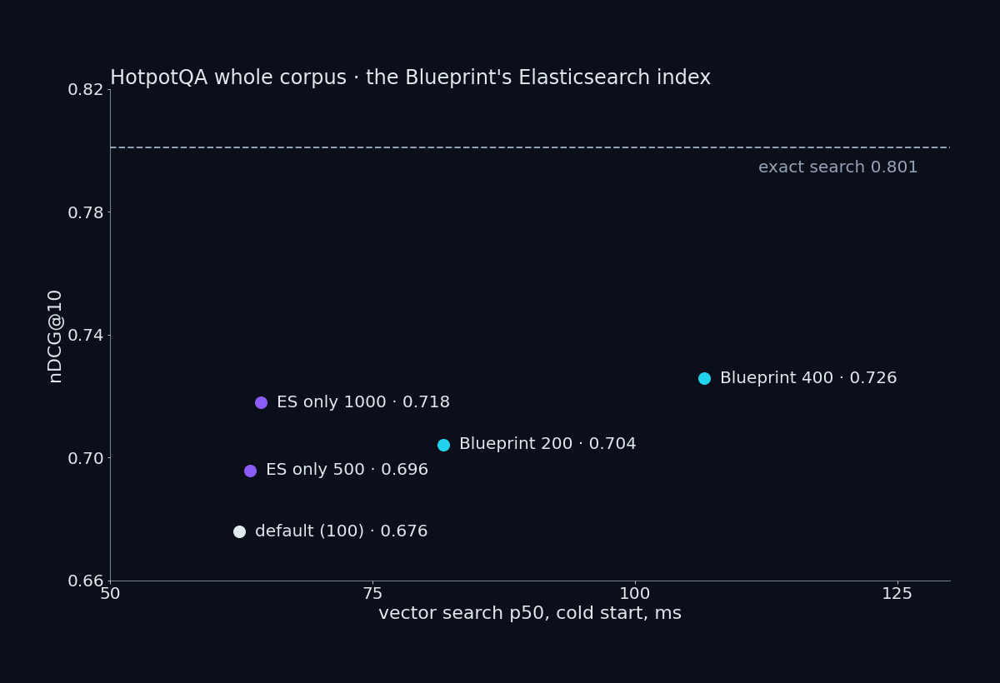

# Vol.5 · The NVIDIA RAG Blueprint's default path on one RTX 5090, on Vol.4's corpora

**Measurements complete (2026-10-18 to 2026-10-22); not yet published as an article.** Everything below is read from the result files of this folder; the table at the end gives the file and key of every number.

The [NVIDIA RAG Blueprint](https://github.com/NVIDIA-AI-Blueprints/rag) v2.6.2 is run here as it ships, with three changes (below), on the corpora of [Vol.4](../vol4-retriever/README.md): BEIR HotpotQA (5,233,329 passages, 7,405 questions, English) and MIRACL zh (4,934,368 passages, 393 questions). Vol.4 measured the retrieval models alone; this volume measures the Blueprint's whole query path around them.

## Four questions, four answers

| # | Question | Answer |
|---|---|---|
| Q1 | How much does the Blueprint's default vector store (Elasticsearch, `bbq_hnsw`) lose against exact search on a whole corpus? | HotpotQA: nDCG@10 **0.676** against **0.801** exact. The one setting the Blueprint exposes, `VECTOR_DB_TOPK`, reaches 0.726 at its limit of 400 |
| Q2 | How much better is the Blueprint's answer than no retrieval, and how far from the right passages? | Answers containing the gold answer: **0.304** with no passages, **0.534** through the Blueprint, **0.728** with the two supporting passages |
| Q3 | Does it answer anyway when the supporting passages are not in the store? | 200 questions: refusals by pattern **0.335** (a lower bound), by hand on 50 **0.540**; **0.120** still contain the gold answer |
| Q4 | What fits on one 32 GB card, and how long does each stage take? | Embedder, reranker and Nemotron 3 Nano share the card after the answer model is ready only at a memory ratio of 0.65; the Blueprint's default request needs a context of **32,768** (at 16,384 all 200 requests were refused). Whole call p50 **1,203 ms** at concurrency 1 |

## The setup

Blueprint v2.6.2 defaults throughout: Elasticsearch 9.3.0, heap 1 GB, `bbq_hnsw`, `VECTOR_DB_TOPK` 100, the reranker, the ten passages sent to the answer model, the prompts, and the answer-model request as the RAG server sends it (`max_tokens` 16256, `temperature` 0, reasoning on with `max_thinking_tokens` 256). Every default with its file and line: [`BLUEPRINT_SETTINGS.md`](BLUEPRINT_SETTINGS.md).

| Change | Why |
|---|---|
| 1 · Embedder `nemotron-3-embed-1b` 2.2.2 fp16 instead of `llama-nemotron-embed-vl-1b-v2` | the whole-corpus vectors of Vol.4 are reused (encoding 5,233,329 passages took 5.2 h there) |
| 2 · Answer model Nemotron 3 Nano 4-bit instead of the default 120B model | the default answer model needs two cards |
| 3 · Vectors loaded into the Blueprint's own index mapping instead of re-computed by its ingestor | the same vectors; two controls below show that the index is the Blueprint's and the vectors are Vol.4's |

**Controls of the three changes.** (a) The Blueprint's query side and Vol.4 produce the same query vectors: cosine at least 0.9999999995 on 20 questions. (b1) Exact search in the Blueprint's index equals exact search with numpy on a 100,000-passage slice for 200 of 200 questions. (b2) The same slice through the Blueprint's own ingestor overlaps 0.982 in the top 100; the difference comes from the ingestor (two faults, listed below), not from the loading.

**Pre-registration.** [`results/night1/prediction_v5_night1.json`](results/night1/prediction_v5_night1.json) and supplements 1 to 7 in the same folder, each with its `.sha256` file, each frozen before the first container of its cells.

## Figures





Program: [`figures/plot_vol5_figures.py`](figures/plot_vol5_figures.py) (`draw`, `check`, `self_test`); every value drawn is in [`figures/figure_points.json`](figures/figure_points.json) with its file and key.

## C1 · The default vector store on a whole corpus

| | HotpotQA | MIRACL zh |
|---|---|---|
| Validity gate: exact search in the index equals numpy, 200 questions | 200 | 200 |
| Mean overlap with the exact top 100 | 0.784 | 0.900 |
| nDCG@10 (exact search, from Vol.4) | 0.676 (0.801) | 0.627 (0.649) |
| Recall@100 | 0.766 | 0.912 |
| Negative control: top-10 overlap with 10 candidates and no rescoring (default) | 0.486 (0.818) | 0.707 (0.938) |
| Loading the vectors (s) | 12,070 | 11,176 |
| Index on disk (bytes) | 52,937,439,647 | 49,608,148,722 |
| Vector search p50 at a cold start (ms) | 62.3 | 161.9 |

The cold start restarts Elasticsearch and drops the host's page cache before each setting: a probe on questions asked shortly before runs from memory and is faster (two such probes were voided: [`results/night3/VOID_latency_1000_and_redo.json`](results/night3/VOID_latency_1000_and_redo.json)).

**The one setting.** `VECTOR_DB_TOPK` sets both `k` and `num_candidates` and stops at 400 (the request field `vdb_top_k` has `le=400`: `src/nvidia_rag/rag_server/server.py:446-450` of the Blueprint at v2.6.2, read into [`results/forum_counts.json`](results/forum_counts.json)). On the same index state: default 0.676 at 62.3 ms, 200 → 0.704 at 81.7 ms, 400 → 0.726 at 106.6 ms. Elasticsearch's own `num_candidates`, which the Blueprint does not expose, gives 0.696 at 500 and 0.718 at 1000 with `k` 100, at about the default latency. At 200 it returns the default's top 100 for 7,405 of 7,405 questions.

## C2 · Answers, three arms

Same answer model, same container, same request; only the passages change. Score: the normalised answer contains the gold answer (main), token F1, exact match.

| Arm | Passages | Contains (Wilson 95%) | F1 | Refusals by pattern |
|---|---|---|---|---|
| N | none | 0.304 (0.294–0.315) | 0.285 | 85 |
| P | the Blueprint's path: 100 found, reranked, top 10 | 0.534 (0.522–0.545) | 0.460 | 829 |
| O | the two supporting passages | 0.728 (0.717–0.738) | 0.618 | 49 |

Paired (exact McNemar): P right and N wrong on 2,090 questions, the reverse on 389; O right and P wrong on 1,663, the reverse on 227. The ten passages of P hold both supporting passages for 4,271 questions, one for 2,363, none for 771.

**MIRACL zh** has no answer strings, so only arm P is measured there: 90.1% of the 393 questions have a judged-relevant passage among the ten sent.

**The NIM's reasoning parser** (cell R, 200 questions): with `--reasoning-parser nemotron_v3`, as the NIM documentation gives it, the reasoning is separated in 200 of 200 answers and the score does not change (contains 100 against 105 for P on the same questions; exact McNemar p 0.30).

## C3 · Supporting passages kept out

200 HotpotQA questions (seed 20261018); the supporting passages are excluded by a `knn.filter` (`must_not` on the passage ids), which is a pre-filter and changes the graph walk. No excluded passage was returned.

| | Value |
|---|---|
| Refusals by pattern (lower bound) | 67 of 200 |
| Refusals by hand, 50 questions | 27 of 50 (pattern agrees on 46) |
| Still contain the gold answer | 24 of 200 (P on the same questions: 105) |

## C4 · One card

The spill rule, frozen before the cell: shared memory above the sum of each service's steady shared memory alone plus 512 MiB, or a service's memory on the card falling below half of what it had alone. Services start in the order embedder, reranker, answer model.

| Run | Answer model | After ready | Result |
|---|---|---|---|
| Positive control | first, ratio 0.92 (default) | shared 4,239 MiB | spills at steady state, as it must |
| Configurations 1–4 | last, ratio 0.65; context 16,384 or 8,192; 26, 16 or 8 sequences | shared at most 569 MiB; 2,794 while the answer model starts | spill by the rule, only during the start; footprint the same for all four |
| Configuration 5 | last, ratio 0.65, context 32,768, 26 sequences, reasoning parser on | shared at most 575 MiB (allowance 1,199); 2,811 while starting | the Blueprint's default request answered: 200 of 200 at concurrency 1 and 4 |

The card (32,607 MiB) holds 21,909 MiB when the answer model of configuration 5 reports ready and 29,382 MiB a minute later; configurations 1–4, with the Blueprint's default embedder, about 31,000 MiB a minute after ready ([`results/c4/card_used.json`](results/c4/card_used.json)).

**Stages with all three on the card** (configuration 5, the RAG server's own timings, p50 in ms):

| Concurrency | Retrieval (query embedding + search) | Reranking | First token | Whole call (p99) |
|---|---|---|---|---|
| 1 | 62.0 | 150.1 | 306.4 | 1,203 (12,856) |
| 4 | 41.7 | 250.5 | 407.7 | 2,249 (45,704) |

Each service alone on the card, the same 200 questions: reranking 153.8, the answer model's first answer text 1,226, whole answer 1,278.

## Run it: the query path on one card

Five commands, in this order, from a folder that holds a clone of [NVIDIA-AI-Blueprints/rag](https://github.com/NVIDIA-AI-Blueprints/rag) at v2.6.2 as `rag/` and this repository as `NV-benchmark/`. `$NGC_ENV_FILE` is a file holding your NGC key (`NGC_API_KEY=...`). The containers are named `embed`, `rerank` and `nano`; [`compose_es/blueprint_query_path.env`](compose_es/blueprint_query_path.env) points the rag-server at those names. It differs from [`compose_es/c4_n3.env`](compose_es/c4_n3.env), the file the measured runs used, only in the container names.

<!-- run-it commands: begin -->
```bash
# 1 Elasticsearch, as the Blueprint ships it (the second file only renames the container and the volume); creates the network nvidia-rag
docker compose -p p137es -f rag/deploy/compose/vectordb.yaml -f NV-benchmark/vol5-rag-blueprint/compose_es/override_vectordb.yaml up -d

# 2 the embedding NIM (deviation 1: nemotron-3-embed-1b, fp16)
docker run -d --name embed --gpus device=0 --network nvidia-rag --shm-size=16GB --env-file "$NGC_ENV_FILE" \
  -e NIM_ENGINE_MODEL_DOWNLOAD_PROVIDER=ngc -e NIM_ENGINE_PRECISION=fp16 \
  -v ~/nim/weights/nemotron-3-embed-1b-nim-2.2.2:/model -v ~/nim/cache/nemotron-3-embed-1b-2.2.2:/opt/cache \
  nvcr.io/nim/nvidia/nemotron-3-embed-1b:2.2.2

# 3 the reranking NIM, as shipped
docker run -d --name rerank --gpus device=0 --network nvidia-rag --shm-size=16GB --env-file "$NGC_ENV_FILE" \
  -v ~/nim/cache/llama-nemotron-rerank-1b-v2-1.10.0:/opt/nim/.cache \
  nvcr.io/nim/nvidia/llama-nemotron-rerank-1b-v2:1.10.0

# 4 the answer NIM (deviation 2), last, with the settings that fit next to the other two and accept the Blueprint's requests
#   (NIM_KVCACHE_PERCENT is the share of the card the NIM gives vLLM as gpu_memory_utilization)
docker run -d --name nano --gpus device=0 --network nvidia-rag --shm-size=16GB --env-file "$NGC_ENV_FILE" \
  --user 0 --ulimit nofile=65536:65536 \
  -e NIM_ENABLE_CHUNKED_PREFILL=1 -e NCCL_NVLS_ENABLE=0 -e VLLM_USE_FLASHINFER_MOE_FP8=0 \
  -e NIM_MODEL_PROFILE=1fba9ecfcfb4cde28d4ce3fd55c40bca89a5a613e25e98f057befe6a7e99eada \
  -e NIM_MAX_MODEL_LEN=32768 -e NIM_KVCACHE_PERCENT=0.65 \
  -e "NIM_PASSTHROUGH_ARGS=--max-num-seqs 26 --reasoning-parser nemotron_v3" \
  -v ~/.cache/nim:/opt/nim/.cache \
  nvcr.io/nim/nvidia/nemotron-3-nano:2.0.12

# 5 the Blueprint's rag-server, the two model names changed; PROMPT_CONFIG_FILE holds {} (no prompt overridden)
export PROMPT_CONFIG_FILE=$PWD/NV-benchmark/vol5-rag-blueprint/compose_es/prompt_overrides_none.yaml
docker compose -p p137rag --env-file NV-benchmark/vol5-rag-blueprint/compose_es/blueprint_query_path.env --env-file "$NGC_ENV_FILE" \
  -f rag/deploy/compose/docker-compose-rag-server.yaml \
  -f NV-benchmark/vol5-rag-blueprint/compose_es/override_rag_server.yaml \
  up -d rag-server
```
<!-- run-it commands: end -->

The index itself is not one of the five: Vol.5 loaded the vectors of Vol.4 directly (deviation 3, [`scripts/es_bulk_load.py`](scripts/es_bulk_load.py)). On Docker Desktop with Git Bash, set `MSYS_NO_PATHCONV=1` first.

## What a reader meets with the defaults

| # | Fact | Where |
|---|---|---|
| 1 | The ingestor (nv-ingest 26.3.0, pinned by the Blueprint) drops the last token of every text chunk: 99,721 of 100,000 passages. It is a regression: [NVIDIA/NeMo-Retriever#497](https://github.com/NVIDIA/NeMo-Retriever/pull/497) fixed the slice (merged 2025-02-28), and [#485](https://github.com/NVIDIA/NeMo-Retriever/pull/485) (merged 2025-03-20) moved the splitter with the slice as it was before the fix | [`results/night1/control_b_diagnosis.json`](results/night1/control_b_diagnosis.json), [`issue_repro/`](issue_repro/) |
| 2 | The ingestor guesses the charset: 249 of 100,000 short UTF-8 passages with a few non-ASCII characters were decoded as another encoding | same file, [`results/c2/unit_repro_decode.json`](results/c2/unit_repro_decode.json) |
| 3 | The default store loses 0.125 nDCG@10 against exact search on 5.2 million passages | C1 |
| 4 | `max_thinking_tokens` 256 has no effect: median reasoning of arm N 326 tokens; 105 of 200 above 256 with the parser on | [`results/c2/token_and_strip_detail.json`](results/c2/token_and_strip_detail.json), [`results/night3/r_vs_p.json`](results/night3/r_vs_p.json) |
| 5 | Without the reasoning parser the answer model emits only the closing reasoning tag, the Blueprint's filter does not remove the reasoning, and the reader sees it | C2, cell R |
| 6 | `max_tokens` 16256 needs a context of more than 16,256 plus the prompt: at 16,384 every prompt above 128 tokens is refused | [`results/c4/ready1_400_diagnosis.json`](results/c4/ready1_400_diagnosis.json), [`results/c4/ready5_alone_probe.json`](results/c4/ready5_alone_probe.json) |
| 7 | The three query services share one 32 GB card only below the default memory ratio; 0.65 is the value that worked here, not a documented one | C4 |
| 8 | Hybrid search with the default ranker (`APP_VECTORSTORE_SEARCHTYPE=hybrid`, `APP_VECTORSTORE_RANKER_TYPE` left at `rrf`) is refused by the Elasticsearch the Blueprint ships: basic licence, HTTP 403 "current license is non-compliant for [Reciprocal Rank Fusion (RRF)]", in both query forms | [`results/hybrid_limits/probe.json`](results/hybrid_limits/probe.json) |
| 9 | Hybrid search with `APP_VECTORSTORE_RANKER_TYPE=weighted` fixes `num_candidates` at 100 and sets `k` to `VECTOR_DB_TOPK` (`src/nvidia_rag/utils/vdb/elasticsearch/es_queries.py:239-275`): above 100, Elasticsearch refuses the search (HTTP 400, "[num_candidates] cannot be less than [k]") | same file |

## What this does not show

- Only the Blueprint's default query path. Extraction (layout, tables, OCR) is not measured: the corpora are text passages.
- MIRACL ja is not run. MIRACL zh has no answer strings, so only retrieval and the passages sent are measured there.
- One card, one host (Windows 11, Docker Desktop on WSL2, driver 617.42). The memory counters are Windows's; the spill during the answer model's start may differ on Linux.
- Concurrency 1 and 4 only; no claim about how many people one card can serve.
- HotpotQA dev and MIRACL dev are evaluation sets. A system compared with these numbers must not be tuned or trained on them.
- No Blueprint setting was tuned. A tuning round was pre-registered and frozen on 2026-10-22 and was not run; the pre-registration is not published.

## Claim → evidence

Paths are relative to this folder. `Check`: `rounds` (the stored value rounds to the number), `equals`, `text` (the literal occurs in the file).

| In the post | Number | File | Key | Check |
|---|---|---|---|---|
| HotpotQA: passages | 5,233,329 | `results/night1/c1_index.json` | `"docs.count":"5233329"` | text |
| HotpotQA: questions scored | 7,405 | `results/night1/c1_score.json` | `metrics.queries_scored` | rounds |
| HotpotQA, default store: nDCG@10 · Recall@100 | 0.676 · 0.766 | `results/night1/c1_score.json` | `metrics.{ndcg_cut_10,recall_100}` | rounds |
| HotpotQA, exact search (Vol.4) | 0.801 | `../vol4-retriever/results/hotpotqa_whole_corpus/whole_corpus/beir-hotpotqa/score.json` | `metrics.ndcg_cut_10` | rounds |
| HotpotQA: mean overlap with the exact top 100 · top 10 | 0.784 · 0.818 | `results/night1/c1_score.json` | `{overlap_at_100.mean,overlap_at_10.mean}` | rounds |
| HotpotQA negative control: top-10 overlap | 0.486 | `results/night1/c1_negative_score.json` | `overlap_at_10.mean` | rounds |
| HotpotQA validity gate | 200 | `results/night1/control_b1_gate.json` | `passed` | rounds |
| Control (a): lowest cosine | 0.9999999995 | `results/night1/control_a.json` | `cosine_min` | rounds |
| Control (b2): overlap in the top 100 | 0.982 | `results/night1/control_b2.json` | `overlap_at_100.mean` | rounds |
| Ingestor: passages without their last token · changed inside | 99,721 · 249 | `results/night1/control_b_diagnosis.json` | `ingestor_text.{only_the_end_missing,changed_inside}` | rounds |
| HotpotQA: loading the vectors (s) | 12,070 | `results/night1/events.jsonl` | `"seconds": 12070` | text |
| HotpotQA: index on disk (bytes) | 52,937,439,647 | `results/night1/c1_index.json` | `"store.size":"52937439647"` | text |
| HotpotQA: vector search p50, cold start (ms) | 62.3 | `results/night3/latency_cold/blueprint_100.json` | `settings.blueprint:100.ms.p50` | rounds |
| `VECTOR_DB_TOPK` 200: nDCG@10 · cold p50 (ms) | 0.704 · 81.7 | `results/day3/nc_blueprint_200_score.json` | `{metrics.ndcg_cut_10,results/night3/latency_cold/blueprint_200.json::settings.blueprint:200.ms.p50}` | rounds |
| `VECTOR_DB_TOPK` 400: nDCG@10 · cold p50 (ms) | 0.726 · 106.6 | `results/day3/nc_blueprint_400_score.json` | `{metrics.ndcg_cut_10,results/night3/latency_cold/blueprint_400.json::settings.blueprint:400.ms.p50}` | rounds |
| ES `num_candidates` 500 · 1000: nDCG@10 | 0.696 · 0.718 | `results/day3/nc_es-only_500_score.json` | `{metrics.ndcg_cut_10,results/day3/nc_es-only_1000_score.json::metrics.ndcg_cut_10}` | rounds |
| ES `num_candidates` 200: questions with the default's top 100 | 7,405 | `results/day3/nc_es200_vs_100_now.json` | `identical` | rounds |
| MIRACL zh: nDCG@10 · Recall@100 · overlap at 100 | 0.627 · 0.912 · 0.900 | `results/day3/zh_score.json` | `{metrics.ndcg_cut_10,metrics.recall_100,overlap_at_100.mean}` | rounds |
| MIRACL zh, exact search (Vol.4) | 0.649 | `../vol4-retriever/results/whole_corpus_quality/whole_corpus/miracl-zh/score.json` | `metrics.ndcg_cut_10` | rounds |
| MIRACL zh: validity gate · negative control top-10 overlap · default top-10 overlap | 200 · 0.707 · 0.938 | `results/day3/zh_validity_gate.json` | `{passed,results/day3/zh_negative_score.json::overlap_at_10.mean,results/day3/zh_score.json::overlap_at_10.mean}` | rounds |
| MIRACL zh: loading the vectors (s) | 11,176 | `results/day3/events.jsonl` | `"seconds": 11176` | text |
| MIRACL zh: index on disk (bytes) | 49,608,148,722 | `results/day3/zh_index.json` | `"store.size":"49608148722"` | text |
| MIRACL zh: vector search p50, cold start (ms) | 161.9 | `results/night3/latency_cold/zh_blueprint_100.json` | `settings.blueprint:100.ms.p50` | rounds |
| Arm N: contains · F1 · refusals | 0.304 · 0.285 · 85 | `results/c2/score_n_o.json` | `N.{contains_rate,f1_mean,refused_by_pattern}` | rounds |
| Arm N: Wilson 95% | 0.294 · 0.315 | `results/c2/score_n_o.json` | `N.{contains_wilson95[0],contains_wilson95[1]}` | rounds |
| Arm O: contains · F1 · refusals | 0.728 · 0.618 · 49 | `results/c2/score_n_o.json` | `O.{contains_rate,f1_mean,refused_by_pattern}` | rounds |
| Arm O: Wilson 95% | 0.717 · 0.738 | `results/c2/score_n_o.json` | `O.{contains_wilson95[0],contains_wilson95[1]}` | rounds |
| Arm P: contains · F1 · refusals | 0.534 · 0.460 · 829 | `results/night3/p_score.json` | `score.{contains_rate,f1_mean,refused_by_pattern}` | rounds |
| Arm P: Wilson 95% | 0.522 · 0.545 | `results/night3/p_score.json` | `score.{contains_wilson95[0],contains_wilson95[1]}` | rounds |
| P vs N: only P right · only N right | 2,090 · 389 | `results/night3/p_score.json` | `paired_P_N.{only_a,only_b}` | rounds |
| P vs O: only O right · only P right | 1,663 · 227 | `results/night3/p_score.json` | `paired_P_O.{only_b,only_a}` | rounds |
| P's ten passages: both · one · none of the supporting passages | 4,271 · 2,363 · 771 | `results/night3/p_score.json` | `supporting_passages_among_the_ten.{both,one,none}` | rounds |
| MIRACL zh P: share with a judged-relevant passage | 0.901 | `results/night3/zh_p_judged.json` | `share` | rounds |
| Cell R: reasoning separated · above 256 tokens | 200 · 105 | `results/night3/r_vs_p.json` | `R.{reasoning_separated,reasoning_tokens_above_256}` | rounds |
| Cell R: contains · P on the same questions | 100 · 105 | `results/night3/r_vs_p.json` | `{R.contains,P_same_questions.contains}` | rounds |
| Cell R vs P: exact McNemar p | 0.30 | `results/night3/r_vs_p.json` | `paired_R_P.mcnemar_exact_p` | rounds |
| Arm N: median reasoning tokens | 326 | `results/c2/token_and_strip_detail.json` | `N.reasoning_tokens_median_closed` | rounds |
| C3: refusals by pattern · share | 67 · 0.335 | `results/night3/c3_refusals.json` | `{refused_by_pattern,refusal_rate}` | rounds |
| C3, by hand: refusals · agreement · share | 27 · 46 · 0.540 | `results/night3/c3_label_check.json` | `{hand_refusal,agree,hand_refusal / items}` | rounds |
| C3: still contain the gold answer · share · P on the same questions | 24 · 0.120 · 105 | `results/night3/c3_contains.json` | `{C3.contains,C3.contains_rate,P_same_questions.contains}` | rounds |
| C4 positive control: shared at most (MiB) | 4,239 | `results/c4/c4_summary.json` | `pc.shared_peak_mib` | rounds |
| C4 configurations 1–4: shared at most after ready · during the start (MiB) | 569 · 2,794 | `results/c4/c4_summary.json` | `{c1.peak_after_answer_model_ready_mib,c1.shared_peak_mib}` | rounds |
| C4 configuration 5: after ready · allowance · whole run (MiB) | 575 · 1,199 · 2,811 | `results/c4/ready5_after_ready.json` | `{window_max_mib,allowance_mib,whole_run_max_mib}` | rounds |
| C4 configuration 5: the default request at context 32,768, statuses | 200 · 200 | `results/c4/ready5_alone_probe.json` | `{requests[0].status,requests[1].status}` | rounds |
| C4 configuration 5: max_model_len read back | 32,768 | `results/c4/ready5_alone_probe.json` | `max_model_len[0]` | rounds |
| C4 context 16,384: the refusal | 128 | `results/c4/ready1_400_diagnosis.json` | `at least 129 input tokens` | text |
| C4 card used at ready · a minute later, configuration 5 (MiB) | 21,909 · 29,382 | `results/c4/card_used.json` | `configurations.ready5.{at_answer_model_ready_mib,at_configuration_complete_mib}` | rounds |
| C4 card used a minute later, configuration 1 (MiB) | 31,000 | `results/c4/card_used.json` | `configurations.c1.at_configuration_complete_mib` | rounds |
| C4 configuration 5, c = 1: answered · retrieval · reranking · first token · whole · p99 (ms) | 200 · 62.0 · 150.1 · 306.4 · 1,203 · 12,856 | `results/c4/ready5_c1.json` | `{ok,fields.retrieval_time_ms.p50,fields.context_reranker_time_ms.p50,fields.rag_ttft_ms.p50,fields.client_total_ms.p50,fields.client_total_ms.p99}` | rounds |
| C4 configuration 5, c = 4: answered · retrieval · reranking · first token · whole · p99 (ms) | 200 · 41.7 · 250.5 · 407.7 · 2,249 · 45,704 | `results/c4/ready5_c4.json` | `{ok,fields.retrieval_time_ms.p50,fields.context_reranker_time_ms.p50,fields.rag_ttft_ms.p50,fields.client_total_ms.p50,fields.client_total_ms.p99}` | rounds |
| Alone: reranking · first answer text · whole answer (ms) | 153.8 · 1,226 · 1,278 | `results/c4/not_coresident/rank.json` | `{fields.rank_ms.p50,results/c4/not_coresident/llm.json::fields.first_answer_ms.p50,results/c4/not_coresident/llm.json::fields.done_ms.p50}` | rounds |
| Vol.4: encoding HotpotQA (h) | 5.2 | `../vol4-retriever/results/hotpotqa_whole_corpus/README.md` | `in one stretch (5.2 h)` | text |

<!-- forum post claims: generated, do not edit by hand -->

### Claim → evidence: the forum post

Every number of the forum post and its first reply that the table above does not already hold. Rows marked `text` point to the line that states the fact; `equals` rows are counts or flags.

**Corpora**

| In the post | Number | File | Key | Check |
|---|---|---|---|---|
| MIRACL zh: passages in the index | 4,934,368 | `results/day3/zh_index.json` | `"docs.count":"4934368"` | text |
| HotpotQA: '5.2M passages', the index's document count | 5.2 | `results/night1/c1_index.json` | `"docs.count":"5233329"` | text |

**The answer, with and without retrieval**

| In the post | Number | File | Key | Check |
|---|---|---|---|---|
| Knowledge base off (arm N): contains the answer, % | 30.4 | `results/c2/score_n_o.json` | `N.contains_rate * 100` | rounds |
| Blueprint default path (arm P): contains the answer, % | 53.4 | `results/night3/p_score.json` | `score.contains_rate * 100` | rounds |
| Supporting passages given (arm O): contains the answer, % | 72.8 | `results/c2/score_n_o.json` | `O.contains_rate * 100` | rounds |
| Arm P: both supporting passages among the ten, % of the questions | 57.7 | `results/night3/p_score.json` | `supporting_passages_among_the_ten.both / results/night1/c1_score.json::metrics.queries_scored * 100` | rounds |
| Arm P: refusals by pattern, % of the questions | 11.2 | `results/night3/p_score.json` | `score.refused_by_pattern / results/night1/c1_score.json::metrics.queries_scored * 100` | rounds |
| MIRACL zh, arm P: questions | 393 | `results/night3/zh_p_judged.json` | `questions` | equals |
| MIRACL zh, arm P: a judged-relevant passage among the ten, % | 90.1 | `results/night3/zh_p_judged.json` | `share * 100` | rounds |
| The same: Wilson 95% low, % | 86.7 | `results/night3/zh_p_judged.json` | `wilson95[0] * 100` | rounds |
| The same: Wilson 95% high, % | 92.7 | `results/night3/zh_p_judged.json` | `wilson95[1] * 100` | rounds |
| MIRACL zh, arm P: answers that hit the output limit | 26 | `results/night3/zh_p_refusals.json` | `finish_reason.length` | equals |

**The vector store at full scale**

| In the post | Number | File | Key | Check |
|---|---|---|---|---|
| HotpotQA: nDCG@10 lost by the default index against exact search | 0.125 | `results/night1/c1_score.json` | `../vol4-retriever/results/hotpotqa_whole_corpus/whole_corpus/beir-hotpotqa/score.json::metrics.ndcg_cut_10 - metrics.ndcg_cut_10` | rounds |
| HotpotQA: nDCG@10 won back by `VECTOR_DB_TOPK` 400 ('gets 0.05 back') | 0.05 | `results/day3/nc_blueprint_400_score.json` | `metrics.ndcg_cut_10 - results/night1/c1_score.json::metrics.ndcg_cut_10` | rounds |
| Cold p50 of the default search, ms ('from 62') | 62 | `results/night3/latency_cold/blueprint_100.json` | `settings.blueprint:100.ms.p50` | rounds |
| Cold p50 at `VECTOR_DB_TOPK` 400, ms ('to 107') | 107 | `results/night3/latency_cold/blueprint_400.json` | `settings.blueprint:400.ms.p50` | rounds |
| Elasticsearch `num_candidates` 1000, k 100: cold p50, ms | 64.4 | `results/night3/latency_cold/es-only_1000.json` | `settings.es-only:1000.ms.p50` | rounds |
| The reply: `num_candidates` 1000 against the default, extra ms ('about 2 ms') | 2 | `results/night3/latency_cold/es-only_1000.json` | `settings.es-only:1000.ms.p50 - results/night3/latency_cold/blueprint_100.json::settings.blueprint:100.ms.p50` | rounds |
| The reply: the three fast points (default, `num_candidates` 500 and 1000) lie within this many ms ('within 2.1 ms') | 2.1 | `results/night3/latency_cold/es-only_1000.json` | `settings.es-only:1000.ms.p50 - results/night3/latency_cold/blueprint_100.json::settings.blueprint:100.ms.p50` | rounds |
| The same: `num_candidates` 500 lies between them, ms above the default | 1.0 | `results/night3/latency_cold/es-only_500.json` | `settings.es-only:500.ms.p50 - results/night3/latency_cold/blueprint_100.json::settings.blueprint:100.ms.p50` | rounds |
| The index's rescoring: '3×' oversampling in the mapping the Blueprint creates | 3 | `results/night1/c1_vector_mapping.json` | `"oversample":3.0` | text |
| Brute force over the whole HotpotQA store: queries · top-100 overlap with exact search | 5 | `results/night1/c1_brute5_score.json` | `overlap_at_100.queries` | equals |
| The same: mean top-100 overlap | 1 | `results/night1/c1_brute5_score.json` | `overlap_at_100.mean` | equals |

**Ingestion**

| In the post | Number | File | Key | Check |
|---|---|---|---|---|
| Ingestor control: the slice is 100,000 passages | 100,000 | `results/night1/addendum_2_control_b_exact.json` | `100,000-passage slice` | text |

**The request the Blueprint sends**

| In the post | Number | File | Key | Check |
|---|---|---|---|---|
| `max_tokens` in every answer request | 16256 | `results/c2/request_params.json` | `body.max_tokens` | equals |
| The reasoning budget sent ('256 tokens') | 256 | `results/c2/request_params.json` | `body.nvext.max_thinking_tokens` | equals |
| Context 16,384: the NIM's refusal names the context | 16,384 | `results/c4/ready1_400_diagnosis.json` | `maximum context length is 16384 tokens` | text |
| Context 16,384, c = 1: questions sent | 200 | `results/c4/ready1_c1.json` | `questions` | equals |
| Context 16,384, c = 1: questions answered ('refused all 200') | 0 | `results/c4/ready1_c1.json` | `ok` | equals |
| Context 32,768, c = 1: questions answered ('all 200 answered') | 200 | `results/c4/ready5_c1.json` | `ok` | equals |
| Query vectors: questions compared (control a) | 20 | `results/night1/control_a.json` | `questions` | equals |
| Reranking requests captured from rag-server and compared ('5/5') | 5 | `results/c2/p_request_control.json` | `captured_questions` | equals |
| The same: all equal field by field | true | `results/c2/p_request_control.json` | `all_ranking_equal` | equals |
| Answer requests captured from rag-server and compared ('25/25') | 25 | `results/c2/request_control.json` | `captured_requests` | equals |
| The same: all bodies equal | true | `results/c2/request_control.json` | `all_bodies_equal` | equals |

**Supporting passages kept out (C3)**

| In the post | Number | File | Key | Check |
|---|---|---|---|---|
| Refusals by pattern, % | 33.5 | `results/night3/c3_refusals.json` | `refusal_rate * 100` | rounds |
| Manual check: answers labelled | 50 | `results/night3/c3_label_check.json` | `items` | equals |
| Manual check: refusals, % | 54 | `results/night3/c3_label_check.json` | `hand_refusal / items * 100` | rounds |
| Manual check: refusals the pattern missed | 4 | `results/night3/c3_label_check.json` | `items - agree` | equals |
| Manual check: refusals the pattern flagged that a reader did not ('no false ones') | 0 | `results/night3/c3_label_check.json` | `pattern_refusal - (hand_refusal - (items - agree))` | equals |
| Still contain the correct answer, % | 12.0 | `results/night3/c3_contains.json` | `C3.contains_rate * 100` | rounds |

**On the card (C4)**

| In the post | Number | File | Key | Check |
|---|---|---|---|---|
| The answer NIM's memory ratio in configuration 5 | 0.65 | `results/c4/ready5_alone_probe.json` | `gpu_memory_utilization=\"0.65\"` | text |
| The NIM's default ratio (positive control) | 0.92 | `results/night1/addendum_5_c4.json` | `gpu_memory_utilization 0.92` | text |
| Embedding NIM (n3) alone: card memory, MiB | 3,966 | `results/c4/ready5_after_ready.json` | `alone.n3embed.card_delta_mib` | rounds |
| Reranking NIM alone: card memory, MiB | 3,351 | `results/c4/ready5_after_ready.json` | `alone.rank.card_delta_mib` | rounds |
| Answer NIM alone (configuration 5): card memory, MiB | 19,940 | `results/c4/ready5_after_ready.json` | `alone.llm5.card_delta_mib` | rounds |
| Sum of the three services' own shared memory alone, MiB (the 575 MiB is below it) | 687 | `results/c4/ready5_after_ready.json` | `alone.n3embed.shared_mib + alone.rank.shared_mib + alone.llm5.shared_mib` | rounds |
| Positive control: the embedding NIM's start took this share of its memory alone ('less than half') | 0.5 | `results/c4/pc_spill.json` | `starts_below_half[0].card_delta_mib / starts_below_half[0].alone_mib` | within |
| All three, configuration 5, about a minute after ready, MiB | 29,382 | `results/c4/card_used.json` | `configurations.ready5.at_configuration_complete_mib` | rounds |
| All three, the ready cell at context 16,384 (n3), about a minute after ready, MiB | 29,565 | `results/c4/card_used.json` | `configurations.ready1.at_configuration_complete_mib` | rounds |
| All three, configuration 1 (vl), about a minute after ready, MiB | 31,000 | `results/c4/card_used.json` | `configurations.c1.at_configuration_complete_mib` | rounds |
| Positive control: shared in steady state, MiB | 4,239 | `results/c4/c4_summary.json` | `pc.shared_peak_mib` | rounds |
| Shared during the answer NIM's start, highest of the six runs ('up to 2,980 MiB'), MiB | 2,980 | `results/c4/ready1_after_ready.json` | `whole_run_max_mib` | rounds |
| Context lengths and sequence counts of configurations 1-4 ('8,192 / 16,384', '8-26') | 8192:8 | `results/c4/card_used.json` | `"answer_model_setting": "8192:8:0.65"` | text |
| The same, the other end | 16384:26 | `results/c4/card_used.json` | `"answer_model_setting": "16384:26:0.65"` | text |
| c = 1: whole answer p50, s ('1.2 s') | 1.2 | `results/c4/ready5_c1.json` | `fields.client_total_ms.p50 / 1000` | rounds |
| c = 4: whole answer p50, s ('2.2 s') | 2.2 | `results/c4/ready5_c4.json` | `fields.client_total_ms.p50 / 1000` | rounds |
| c = 1: whole answer p99, s | 12.9 | `results/c4/ready5_c1.json` | `fields.client_total_ms.p99 / 1000` | rounds |
| c = 4: whole answer p99, s | 45.7 | `results/c4/ready5_c4.json` | `fields.client_total_ms.p99 / 1000` | rounds |
| c = 4: reranking p50, ms | 250 | `results/c4/ready5_c4.json` | `fields.context_reranker_time_ms.p50` | rounds |
| c = 4: retrieval p50, ms ('42') | 42 | `results/c4/ready5_c4.json` | `fields.retrieval_time_ms.p50` | rounds |

**Counts the post states (results/forum_counts.json, written by scripts/forum_counts.py)**

| In the post | Number | File | Key | Check |
|---|---|---|---|---|
| Setting rows of BLUEPRINT_SETTINGS.md | 206 | `results/forum_counts.json` | `settings_rows` | equals |
| `VECTOR_DB_TOPK` 'tops out at 400': the le= bound of the request field vdb_top_k | 400 | `results/forum_counts.json` | `vdb_top_k_cap.le[0]` | equals |
| The ingestor's time per 100,000 passages, minutes ('1 h 51 min') | 111 | `results/forum_counts.json` | `ingestor_log.seconds_per_100000_passages / 60` | rounds |
| The same rate over the whole HotpotQA corpus, hours ('an estimated 97 hours') | 97 | `results/forum_counts.json` | `ingestor_log.estimate_hours_for_the_whole_hotpotqa_corpus` | rounds |
| The fix the ingestor's defect undoes: NeMo-Retriever#497, merged in 2025 | 2025 | `results/forum_counts.json` | `"mergedAt": "2025-02-28` | text |

**Hybrid search on the Elasticsearch the Blueprint ships (results/hybrid_limits/probe.json)**

| In the post | Number | File | Key | Check |
|---|---|---|---|---|
| The licence of that Elasticsearch | basic | `results/hybrid_limits/probe.json` | `"type": "basic"` | text |
| Default hybrid ranker (rrf), the form the client sends: HTTP status | 403 | `results/hybrid_limits/probe.json` | `asked[0].status` | equals |
| The same, the retriever form: HTTP status | 403 | `results/hybrid_limits/probe.json` | `asked[1].status` | equals |
| Its error text | 403 | `results/hybrid_limits/probe.json` | `current license is non-compliant for [Reciprocal Rank Fusion (RRF)]` | text |
| Weighted hybrid at VECTOR_DB_TOPK 100: HTTP status | 200 | `results/hybrid_limits/probe.json` | `asked[2].status` | equals |
| Weighted hybrid at VECTOR_DB_TOPK 200: HTTP status | 400 | `results/hybrid_limits/probe.json` | `asked[3].status` | equals |
| Weighted hybrid at VECTOR_DB_TOPK 400: HTTP status | 400 | `results/hybrid_limits/probe.json` | `asked[4].status` | equals |
| Its error text | 400 | `results/hybrid_limits/probe.json` | `[num_candidates] cannot be less than [k]` | text |
| Control: kNN alone on the same index: HTTP status | 200 | `results/hybrid_limits/probe.json` | `asked[5].status` | equals |
| Control: match alone on the same index: HTTP status | 200 | `results/hybrid_limits/probe.json` | `asked[6].status` | equals |

**When and on which driver**

| In the post | Number | File | Key | Check |
|---|---|---|---|---|
| The first pre-registration of the sessions in this volume | 18 | `results/night1/prediction_v5_night1.json` | `"written_at": "2026-10-18T` | text |
| The last supplement | 22 | `results/night1/addendum_7_c4_context_32768.json` | `"written_at": "2026-10-22T` | text |
| Supplements ('seven addenda') | 7 | `results/night1/addendum_7_c4_context_32768.json` | `supplement 7` | text |
| The driver | 617.42 | `results/night1/events.jsonl` | `"driver": "617.42"` | text |

Run `python ../tools/check_claims.py README.md` to check these rows with the others.

<!-- end of the forum post claims -->
